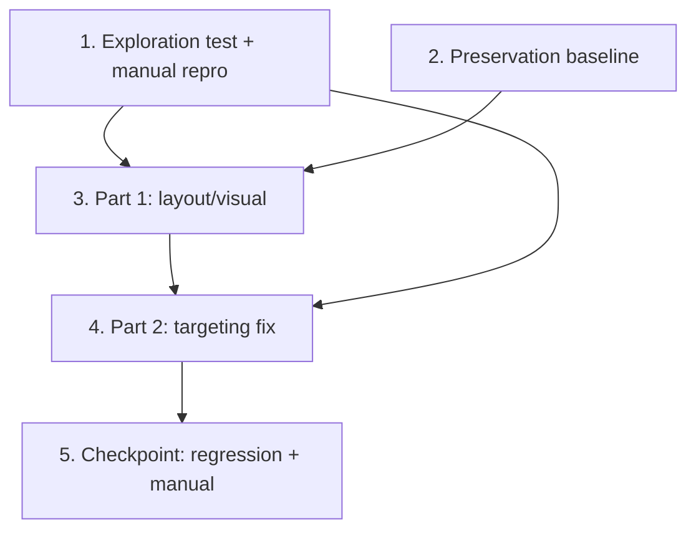

# Implementation Plan

## Overview

A scoped bugfix round on the already-working Ouija board. Work proceeds in two parts:
**Part 1 (layout/visual) first** because it moves element positions, then **Part 2
(planchette targeting) second** because the targeting fix measures those elements with
`getBoundingClientRect()`. Tasks 1–2 establish the bug-condition exploration test and the
preservation baseline before any fix. Only `static/board.js` and `templates/index.html`
change, plus ONE new test file.

## Task Dependency Graph



Task 1 (exploration) and Task 2 (preservation baseline) come first. Part 1 (Task 3) must
complete before Part 2 (Task 4) because layout changes move element positions. Task 5 is
the final checkpoint.

```json
{
  "waves": [
    { "wave": 1, "tasks": ["1", "2"] },
    { "wave": 2, "tasks": ["3"] },
    { "wave": 3, "tasks": ["4"] },
    { "wave": 4, "tasks": ["5"] }
  ]
}
```

## Tasks

> Global constraints for EVERY task below:
> - Do NOT modify `main.py` or the `POST /summon` contract.
> - Do NOT change the behavior of `appendChar` / `appendMarker` / `setName` / `capName` /
>   `charIndex` / `lastArcChar`, and keep the pure core Node-testable.
> - Keep ALL existing tests passing: `npm test` = 24/24, `pytest` = 25 passed.
> - Do NOT edit the existing content of any existing test file.
> - Only `static/board.js` and `templates/index.html` may change, plus ONE NEW test file
>   (`tests/board.rect.prop.test.js`).
> - Plain HTML/CSS/inline SVG/vanilla JS; no frameworks, no external images, no
>   `url()` / `@import`; English only; respect `prefers-reduced-motion`.

- [x] 1. Write bug condition exploration test (rect helper) + document manual YES/NO repro
  - **Property 1: Bug Condition** - Planchette rests on the real on-screen center of its target
  - **CRITICAL**: This test MUST FAIL on unfixed code — failure confirms the bug/fix surface is missing
  - **DO NOT attempt to fix the test or the code when it fails**
  - **NOTE**: This test encodes the expected behavior of the pure rect-center helper; it will validate the fix when it passes after implementation
  - **GOAL**: Surface evidence the targeting fix surface is absent, plus a documented manual repro of YES/NO mis-targeting
  - **Scoped PBT Approach**: Create `tests/board.rect.prop.test.js` (NEW file) that imports `elementCenterInContainer` from `../static/board.js` and asserts, for finite rects with non-negative sizes, that it returns `{x,y}` = target-center − container-origin
  - Run `npx node --test tests/board.rect.prop.test.js` on UNFIXED code — the symbol does not exist yet, so the test FAILS (confirms the fix surface is missing)
  - Document the manual repro in the test file header comment and/or spec notes: load `/`, click YES → planchette glides to the `S` glyph (wrong); click NO → glides to `O` (wrong); because `"YES"`/`"NO"` end in arc letters and the target is `charIndex(lastArcChar(name))`
  - **EXPECTED OUTCOME**: Test FAILS (proves the bug/fix surface exists to fix); do NOT touch existing test files
  - Mark task complete when the new test is written, run, and the failure + manual repro are documented
  - _Requirements: 1.1, 1.2, 1.3_

- [x] 2. Write preservation property checks (BEFORE implementing the fix)
  - **Property 2: Preservation** - Pure core, layout invariants, and server contract unchanged
  - **IMPORTANT**: Follow observation-first methodology — observe current behavior on UNFIXED code
  - Observe and record: `npm test` → 24/24 passing (pure core `board.prop.test.js` + geom `board.geom.prop.test.js`); `pytest` → 25 passed (includes `/summon` 303/200/422, schema, persistence)
  - Record the baseline geom invariants currently asserted: every letter `y <= DIGIT_ROW_Y`, all 36 centers distinct, digits on the right-hand row
  - These existing property suites ARE the preservation tests — do NOT add new ones for the pure core and do NOT edit existing test files
  - **EXPECTED OUTCOME**: all observed suites PASS on unfixed code (baseline to preserve)
  - Mark task complete when the baseline (24/24 JS, 25 Python) is recorded
  - _Requirements: 3.1, 3.2, 3.3, 3.4, 3.5_

## Part 1 — Layout / visual (DO FIRST; these move element positions)

- [x] 3. Fix the Ouija board layout, planchette shape, and glyph typography

  - [x] 3.1 Recenter the letter arc via new geom constants, mirrored in CSS
    - In `static/board.js` `geom`, set: `ARC_START_ANGLE = Math.PI * 1.02`,
      `ARC_END_ANGLE = Math.PI * 1.98`, `ARC_RADIUS = 268`, `ARC_CENTER_X = 350`,
      `ARC_CENTER_Y = 300`. Leave all `DIGIT_*` constants unchanged.
    - In `templates/index.html` CSS, mirror the IDENTICAL numbers in the `.ouija .glyph`
      arc rule: `--ang = calc(π·1.02 + (π·1.98 − π·1.02) * (var(--i) / 25))`,
      `left = calc(350px + 268px * cos(--ang·1rad))`,
      `top  = calc(300px + 268px * sin(--ang·1rad))`.
    - Set CSS `.ouija .glyph` `width`/`height` to `1.7rem` (font-size ~1rem, ≥ 16px).
    - VERIFY with a throwaway node script (delete after) that: letter centers are symmetric
      about `x = 350`; every letter `y <= 300`; `apex y − pill/2 >= 12`; end pills within
      `[12, 688]`; min adjacent letter-center gap `>= pill px (~27.2)`. Then run `npm test`
      (must be 24/24, so `board.geom.prop.test.js` "letter y <= DIGIT_ROW_Y" stays true).
    - _Bug_Condition: isBugCondition(X) — arc asymmetry/overlap (Req 1.4)_
    - _Expected_Behavior: Property 1 / symmetric arc inside inner border, no overlap_
    - _Preservation: Property 2 — geom test green, digits unchanged_
    - _Requirements: 2.4, 3.3, 3.4_

  - [x] 3.2 Confirm responsive scaling keeps glyphs inside the board
    - Verify (no code change expected) that `.ouija` keeps
      `transform: scale(var(--board-scale, 1))`, `max-width: 100%`, and the
      `@media (max-width: 720px)` rule sets `--board-scale: calc((100vw − 2.8rem) / 700)`.
    - Confirm glyphs and planchette are children of the scaled stage so they never overflow
      at narrow widths; adjust only if a glyph is observed to clip.
    - _Bug_Condition: isBugCondition(X) — glyph clipping at viewport widths (Req 1.4)_
    - _Expected_Behavior: every glyph inside the inner border at any width_
    - _Preservation: Property 2 — no test regressions_
    - _Requirements: 2.4_

  - [x] 3.3 Redesign the planchette inline SVG as a classic planchette
    - Replace the map-pin SVG in `templates/index.html` with a classic planchette: wide
      rounded heart/guitar-pick (wider at top, tapering to a soft point), a CLEAR circular
      center window (`fill="none"`) framing the glyph, soft drop shadow, aged-wood body via
      an inline SVG `<defs>` brown gradient, GOLD outline stroke `#e8c372`.
    - Centering contract: controller sets `style.transform = translate(x, y)` inline, so
      center the WINDOW CENTER on that point via negative margins. Use
      `viewBox="0 0 96 96"`, window center `(48, 48)`, CSS `margin: -48px 0 0 -48px`, and
      `width`/`height` matching the 96-unit box.
    - Keep `aria-hidden`, `pointer-events: none`, the `transform` transition + `will-change`,
      and reduced-motion handling intact.
    - _Bug_Condition: isBugCondition(X) — planchette reads as a map pin (Req 1.5)_
    - _Expected_Behavior: classic planchette with clear center window (Req 2.5)_
    - _Preservation: Property 2 — no test regressions_
    - _Requirements: 2.5_

  - [x] 3.4 Kill the Q swash on the engraved serif stack
    - Ensure `.ouija .glyph` and `.ouija .marker` carry `font-variant-ligatures: none` and
      `font-feature-settings: "liga" 0, "clig" 0, "dlig" 0, "hlig" 0, "swsh" 0, "calt" 0`
      on the engraved serif stack, so `Q` renders without a decorative swash.
    - _Bug_Condition: isBugCondition(X) — Q renders with a swash (Req 1.5)_
    - _Expected_Behavior: Q rendered plain (Req 2.5)_
    - _Preservation: Property 2 — no test regressions_
    - _Requirements: 2.5_

## Part 2 — Planchette targeting bug (DO AFTER Part 1)

- [x] 4. Fix planchette targeting to use real element rects

  - [x] 4.1 Add the pure, Node-safe rect-center helper
    - In `static/board.js`, add and EXPORT
      `elementCenterInContainer(targetRect, containerRect)` returning
      `{ x: targetRect.left + targetRect.width/2 − containerRect.left,
         y: targetRect.top  + targetRect.height/2 − containerRect.top }`.
    - Operate on plain `{left, top, width, height}` objects only — no real DOM; keep it
      pure and total.
    - _Bug_Condition: isBugCondition(X) from design_
    - _Expected_Behavior: elementCenterInContainer = target center − container origin_
    - _Preservation: Property 2 — pure core untouched_
    - _Requirements: 2.1, 2.2_

  - [x] 4.2 Rewrite `movePlanchetteTo` to measure the real target element
    - In `createBoard`, change `movePlanchetteTo` so instead of `arcPosition(index)` it
      resolves the target to a DOM element and measures it:
      glyphs → `root.querySelector('button[data-char="X"]')` for the last arc char `X`
      (resolve `index → element` so `movePlanchetteTo(index)` keeps working for
      letters/digits); markers → the clicked marker button element.
    - Compute `elementCenterInContainer(target.getBoundingClientRect(),
      container.getBoundingClientRect())`.
    - Account for board scale: both rects are scaled pixels and the planchette's inline
      `translate` is applied inside the scaled stage, so divide the delta by the current
      scale (`scale = container.getBoundingClientRect().width / geom.STAGE_W`, or read
      `--board-scale`) and document the reasoning in a comment.
    - Preserve the no-move rule: when the name is empty or ends off-arc (`lastArcChar` →
      `null`, no resolvable element), do not move. Keep reduced-motion instant behavior.
    - _Bug_Condition: isBugCondition(X) — pure math drifts from real rect (Req 1.1–1.3)_
    - _Expected_Behavior: Property 1 — rest on real on-screen center (Req 2.1, 2.2)_
    - _Preservation: Property 2 — reduced-motion + no-move rule kept_
    - _Requirements: 2.1, 2.2_

  - [x] 4.3 Wire marker clicks and window resize
    - On YES/NO/GOODBYE button click, target that marker button's rect. GOODBYE clears the
      name; after the clear, target the GOODBYE button (or keep the planchette where it is)
      — pick a sensible behavior and document it in code.
    - Typing continues to target the last arc char's glyph element (so typing "YES"/"NO"
      targets `S` / `O`, by design).
    - Add a `window` resize listener that repositions the planchette to the current target
      (recompute rects on each move).
    - _Bug_Condition: isBugCondition(X) — marker clicks + resize (Req 1.1–1.3)_
    - _Expected_Behavior: marker clicks target marker rects; stays correct after resize (Req 2.1, 2.3)_
    - _Preservation: Property 2 — typing behavior and no-move rule kept_
    - _Requirements: 2.1, 2.3_

  - [x] 4.4 Flesh out the NEW rect-center property test
    - Complete `tests/board.rect.prop.test.js` (NEW file from task 1): for any finite
      target/container rects with non-negative sizes, `elementCenterInContainer` returns
      finite coords equal to target center − container origin; AND when the target is inside
      the container, the center is within `[0, containerWidth] × [0, containerHeight]`.
    - Use `node:test` + `fast-check`, `numRuns >= 100`; tag `Feature:` / `Property N:` /
      `Validates: Requirements 2.1, 2.2`. Do NOT edit existing test files.
    - _Bug_Condition: isBugCondition(X) from design_
    - _Expected_Behavior: Property 1 — helper correctness_
    - _Requirements: 2.1, 2.2_

  - [x] 4.5 Verify bug condition exploration test now passes
    - **Property 1: Expected Behavior** - Planchette rests on the real on-screen center of its target
    - **IMPORTANT**: Re-run the SAME test from task 1 (now completed in 4.4) — do NOT write a new one
    - Run `npx node --test tests/board.rect.prop.test.js`
    - **EXPECTED OUTCOME**: Test PASSES (confirms the rect-center fix surface behaves correctly)
    - _Requirements: 2.1, 2.2_

  - [x] 4.6 Verify preservation checks still pass
    - **Property 2: Preservation** - Pure core, layout invariants, and server contract unchanged
    - **IMPORTANT**: Re-run the SAME baseline suites from task 2 — do NOT write new ones
    - Run `npm test` (expect 24/24 existing + the new rect tests) and `pytest` (expect 25 passed)
    - **EXPECTED OUTCOME**: Tests PASS (no regressions to pure core, geom, or `/summon`)
    - _Requirements: 3.1, 3.2, 3.3, 3.4, 3.5_

- [x] 5. Checkpoint - Full regression and manual verification
  - Run `npm test` → expect 24/24 existing + the new `tests/board.rect.prop.test.js`.
  - Run `pytest` → expect 25 passed. Confirm `main.py` and all existing test files are
    unmodified (`git diff --stat`).
  - Confirm `/summon` still returns 303 (success) / 200 (render) / 422 (validation) via
    FastAPI `TestClient`; clean up any temporary DB/files created.
  - Start the app, `GET /` → 200 showing the new arc geometry + classic planchette.
  - MANUAL browser eyeball notes: planchette lands on the correct element when clicking
    A–Z and 0–9, when clicking YES/NO/GOODBYE, when typing letters, when typing the words
    YES and NO (targets `S` / `O` by design), and after a window resize.
  - Ensure all tests pass; ask the user if questions arise.

## Notes

- Write the exploration test (task 1) and run it on UNFIXED code BEFORE implementing any
  fix — it must fail first (the `elementCenterInContainer` symbol is absent on unfixed
  code), which confirms the fix surface.
- Run the preservation baseline (task 2) on UNFIXED code to record 24/24 JS and 25 Python
  before changing anything.
- Do Part 1 (layout) fully before Part 2 (targeting): layout changes move element
  positions, and the targeting fix measures those real positions.
- The DOM-level targeting is verified by the pure rect-helper property test plus manual
  browser eyeballing (a full DOM harness would be brittle), so manual repro notes are part
  of the acceptance in tasks 1 and 5.
- Never run watch-mode test commands here; use single-run invocations
  (`npm test`, `npx node --test <file>`, `pytest`).
