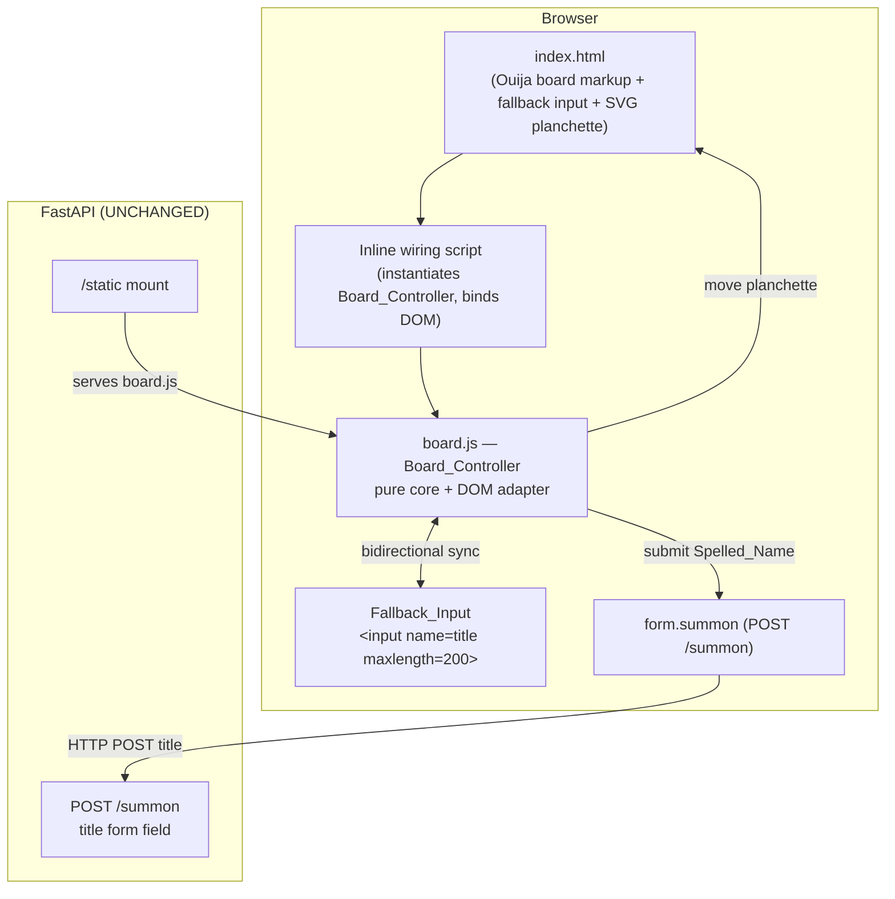

# Design Document

## Overview

The Ouija Summoning Board adds an interactive, séance-themed way to compose a task name on the existing "Séance" app (FastAPI + Jinja2 + SQLite + vanilla JavaScript). Instead of typing directly into the plain text field as the primary action, the user spells a name by activating glyphs on a Ouija-style board: an arc of the 26 uppercase letters A–Z and the 10 digits 0–9, plus three Special_Markers (YES, NO, GOODBYE). An inline-SVG planchette glides to each activated character, producing a spelling-out effect. A standard HTML text input (the existing `<input name="title" maxlength="200">`) remains present as an accessible fallback and stays synchronized with the board in both directions. Activating the Summon_Control submits the Spelled_Name to the unchanged `POST /summon` endpoint using the existing `title` form field.

The guiding constraint is **additive, non-destructive integration**. The design introduces exactly one new static asset, `static/board.js` (the Board_Controller), served under `/static` exactly like `ghost.js` and `banish.js`. It augments `templates/index.html` with new board markup and a small wiring script, reusing the existing dark gothic theme (CSS variables `--bg`, `--text`, `--glow`, `--spirit`, the fog layer, and the Cinzel Decorative / IM Fell English fonts). The server-side request handling in `main.py` — in particular the `/summon` route — is left untouched. If `board.js` fails to load or run, the fallback input and its surrounding `<form class="summon">` continue to work exactly as they do today (progressive enhancement).

The feature is implemented entirely in plain HTML, CSS, inline SVG, and vanilla JavaScript. No frameworks, build steps, or paid APIs are introduced.

### Design Goals

- Keep all new client logic in one static module with a small, pure, testable core.
- Preserve the existing `/summon` HTTP contract (303 success / 200 empty re-render / 422 too-long) byte-for-byte.
- Guarantee graceful degradation: the plain form submits a task even with JavaScript disabled or `board.js` absent.
- Match the existing gothic look without hiding the fog layer.
- Decompose cleanly into small, independently reviewable implementation tasks.

## Architecture

### Component Topology

The feature adds a thin presentation/interaction layer in the browser. Nothing changes on the server.



### Layering Inside `board.js`

`board.js` follows the same dual-layer pattern already established by `ghost.js` and `banish.js`:

1. **Pure core (no DOM, no network).** A set of pure functions and a small state object that own the Spelled_Name logic: appending a character, appending YES/NO text, clearing on GOODBYE, enforcing the 200-character cap, mapping a character to its index on the Character_Arc, and resolving which arc character the planchette should indicate for a given Spelled_Name. These functions are exported for Node-based property tests, exactly as `ghost.js` exports `pickSpooky` and `banish.js` exports `restoreAtIndex`.
2. **DOM adapter (browser only).** Thin functions that read/write the DOM: rendering the arc and markers (if generated in JS) or binding to pre-rendered markup, translating the planchette, updating the fallback input, and submitting the form. All DOM access sits behind `typeof document !== "undefined"` guards so the module can be `require()`d under Node without side effects.

The module uses the same UMD-style IIFE wrapper as `banish.js`: it assigns `window.Board` in the browser and `module.exports` under Node (CommonJS), with no auto-execution of DOM code when loaded in Node.

### Module Loading and Graceful Degradation

The `static/` directory is already mounted at `/static` in `main.py` (`app.mount("/static", StaticFiles(directory="static"), name="static")`). `board.js` is served by that existing mount — no server change is needed. `templates/index.html` references it with `<script src="/static/board.js"></script>`, placed near the existing `ghost.js` / `banish.js` tags.

Graceful degradation is structural, not conditional:

- The board markup is decorative/enhancing; the **fallback input and its form are always present in the HTML** and are a fully functional, standalone summon path.
- The inline wiring script checks `window.Board` before using it and does nothing if the module is unavailable.
- If the board is active, it keeps the fallback input in sync so a user can switch to typing at any time.
- The Summon_Control is a real submit control of `form.summon`; even if `board.js` fails after render, the form still posts `title` to `/summon`.

## Components and Interfaces

### 1. Markup additions to `templates/index.html`

New structure placed inside the existing `<form class="summon" method="post" action="/summon">`, around the existing input:

- A **Ouija_Board container** (`<div class="ouija" ...>`), containing:
  - The **Character_Arc**: 36 activatable controls (`<button type="button" class="glyph" data-char="A">…`), one per character A–Z and 0–9, positioned along an arc via CSS using per-glyph custom properties for angle/offset.
  - The **Special_Markers**: three activatable controls (`<button type="button" class="marker" data-marker="YES|NO|GOODBYE">`), labeled in English.
  - The **Planchette**: an inline `<svg class="planchette" aria-hidden="true">…</svg>` positioned absolutely over the arc and moved by a CSS transform.
- The existing **Fallback_Input** (`<input name="title" maxlength="200" aria-label="New task">`) is kept, with its accessible English label, as the synchronized text fallback.
- The existing **Summon_Control** (`<button type="submit">Summon</button>`) remains the real submit button of the form.

All glyph/marker buttons use `type="button"` so activating them does not submit the form; only the Summon_Control (`type="submit"`) submits. All visible text stays in English.

### 2. `static/board.js` — Board_Controller

**Exported pure core (testable under Node):**

```
// Character_Arc definition
ARC_CHARS : string            // "ABCDEFGHIJKLMNOPQRSTUVWXYZ0123456789" (36 chars)
MAX_TITLE_LENGTH : number     // 200

// --- Spelled_Name transforms (pure: (state, input) -> newState) ---
appendChar(name, ch)          // append a single arc character, respecting cap
appendMarker(name, marker)    // "YES"/"NO" -> append text; "GOODBYE" -> clear
capName(name)                 // returns name truncated/guarded to <= MAX_TITLE_LENGTH
setName(raw)                   // adopt an external value (fallback edit), capped

// --- Planchette resolution (pure) ---
charIndex(ch)                 // index of ch within ARC_CHARS, or -1 if absent
lastArcChar(name)             // last character of name that is present on the arc, or null
arcAngle(index, count)        // angle (radians/degrees) for a glyph index on the arc
arcPosition(index, count, geom) // {x, y} center of a glyph for planchette targeting
```

**Transform contracts:**

- `appendChar(name, ch)`: returns `name + ch` if the result length `<= MAX_TITLE_LENGTH`; otherwise returns `name` unchanged. Pure; does not mutate `name`.
- `appendMarker(name, "YES")`: equivalent to appending the literal string `"YES"` under the same cap rule (appends only if the full `"YES"` fits; otherwise unchanged). `"NO"` behaves the same with `"NO"`.
- `appendMarker(name, "GOODBYE")`: returns `""` (clears the Spelled_Name) regardless of current content.
- `setName(raw)`: returns `raw` if `raw.length <= MAX_TITLE_LENGTH`, else the first `MAX_TITLE_LENGTH` characters. Models adopting an edited fallback value.
- `charIndex(ch)`: case-insensitive match against `ARC_CHARS` is **not** performed by the core — `ARC_CHARS` is uppercase + digits; the DOM adapter uppercases single-letter input before calling. The core treats input literally and returns `-1` when `ch` is not an exact member.
- `lastArcChar(name)`: scans `name` from the end and returns the first character that is a member of `ARC_CHARS`; returns `null` if none (e.g., name ends in a lowercase letter not present, punctuation, or is empty).

**Browser-only adapter:**

```
createBoard(options) -> controller
  options.root        // Ouija_Board container element
  options.input       // Fallback_Input element
  options.planchette  // SVG planchette element
  options.reduceMotion// boolean override (defaults to matchMedia prefers-reduced-motion)

controller.activateChar(ch)     // append + move planchette + sync input
controller.activateMarker(m)    // YES/NO append or GOODBYE clear + sync + planchette
controller.syncFromInput()      // adopt fallback value -> state, move planchette to last arc char
controller.value()              // current Spelled_Name
controller.movePlanchetteTo(index) // translate SVG to glyph position (animated or instant)
```

The adapter wires: glyph button `click` → `activateChar(dataChar)`; marker button `click` → `activateMarker(dataMarker)`; fallback input `input` event → `syncFromInput()`. After every state change it writes `controller.value()` back into `options.input.value` (board→input sync) and repositions the planchette to `lastArcChar` of the current name.

### 3. Inline wiring script in `templates/index.html`

A small IIFE (mirroring the existing mascot wiring) that:

1. Returns early if `window.Board` or `Board.createBoard` is unavailable (graceful degradation).
2. Looks up the board container, planchette SVG, and the existing `input[name="title"]`.
3. Calls `Board.createBoard({...})` and lets the controller bind its own listeners.

The Summon_Control needs no JS: it is the form's native submit button. The controller only keeps `input.value` equal to the Spelled_Name so the native POST already carries the right `title`.

### 4. Server (unchanged)

`main.py`’s `/summon` handler, `/banish`, templates wiring, and the `/static` mount are **not modified**. The board posts through the existing form, so the 303 / 200 / 422 contract and `MAX_TITLE_LENGTH = 200` server-side validation are preserved as-is.

## Data Models

### Spelled_Name

A single immutable string value (JavaScript `string`) representing the task name under construction. The pure core never mutates it; transforms return new strings.

- Domain: any string with `length <= MAX_TITLE_LENGTH` (200).
- Characters may include arc characters (A–Z, 0–9) appended via the board, literal marker text (`YES`, `NO`), and arbitrary characters introduced by the user editing the Fallback_Input.
- The empty string `""` is the cleared/initial state (also the result of GOODBYE).

### Character_Arc model

```
ARC_CHARS = "ABCDEFGHIJKLMNOPQRSTUVWXYZ0123456789"   // length 36
index(ch)  = position of ch in ARC_CHARS, or -1
count       = ARC_CHARS.length (36)
```

Geometry (used by `arcAngle` / `arcPosition`): glyphs are laid out along a circular arc. For a glyph at `index` out of `count`, the angle sweeps from a start angle to an end angle:

```
angle(index) = START_ANGLE + (END_ANGLE - START_ANGLE) * index / (count - 1)
position(index) = {
  x: CENTER_X + RADIUS * cos(angle(index)),
  y: CENTER_Y + RADIUS * sin(angle(index))
}
```

`START_ANGLE`, `END_ANGLE`, `RADIUS`, `CENTER_X`, `CENTER_Y` are layout constants (grouped in a `geom` object) shared between CSS glyph placement and the planchette-targeting math so the planchette lands on glyph centers. The planchette is moved with `transform: translate(x, y)` (plus an optional rotation toward the glyph); CSS `transition` animates the translate when motion is allowed, and the transition is disabled under `prefers-reduced-motion: reduce` (consistent with the existing global reduced-motion rule in `index.html`).

### Special_Marker model

```
MARKERS = { YES: "YES", NO: "NO", GOODBYE: <clear> }
```

YES/NO map to literal text appended under the cap rule; GOODBYE maps to the clear operation.

### Planchette target resolution

For a given Spelled_Name, the planchette target is:

```
target(name) = charIndex(lastArcChar(name))   // -1/null => planchette stays / hidden-neutral
```

This single rule covers both board-driven appends (last char is the just-activated glyph) and fallback edits (last typed char, if it is on the arc).

## Correctness Properties

*A property is a characteristic or behavior that should hold true across all valid executions of a system — essentially, a formal statement about what the system should do. Properties serve as the bridge between human-readable specifications and machine-verifiable correctness guarantees.*

The Board_Controller pure core is a set of deterministic string/index functions with large input spaces (arbitrary names, arbitrary characters, every arc index), which makes it well suited to property-based testing in the same lightweight `fast-check` + `node:test` style already used by `ghost.prop.test.js` and `banish.prop.test.js`.

### Property 1: Appending an arc character grows the name by that character when under the cap

*For any* Spelled_Name whose length is less than MAX_TITLE_LENGTH and any character `ch` on the Character_Arc, `appendChar(name, ch)` equals `name + ch` and has length `name.length + 1`.

**Validates: Requirements 2.1**

### Property 2: Appending never exceeds the maximum length and never shrinks the name

*For any* Spelled_Name and any arc character `ch`, the result of `appendChar(name, ch)` has length at most MAX_TITLE_LENGTH, and its length is greater than or equal to `name.length`; and if appending would exceed MAX_TITLE_LENGTH the result equals `name` unchanged.

**Validates: Requirements 2.5**

### Property 3: YES and NO append their literal text under the cap rule

*For any* Spelled_Name and any marker `m` in {YES, NO}, if `name.length + m.length <= MAX_TITLE_LENGTH` then `appendMarker(name, m)` equals `name + m`; otherwise it equals `name` unchanged.

**Validates: Requirements 2.2, 2.3, 2.5**

### Property 4: GOODBYE always clears the name

*For any* Spelled_Name, `appendMarker(name, "GOODBYE")` equals the empty string `""`.

**Validates: Requirements 2.4**

### Property 5: Character-to-arc-index lookup is sound and exhaustive over the arc

*For any* index `i` in `[0, ARC_CHARS.length)`, `charIndex(ARC_CHARS[i])` equals `i`; and *for any* character not present in `ARC_CHARS`, `charIndex(ch)` equals `-1`.

**Validates: Requirements 3.1, 3.4**

### Property 6: The planchette target is the last arc character of the name

*For any* Spelled_Name, `lastArcChar(name)` is either `null` (when no character of `name` is on the arc) or a character that is a member of `ARC_CHARS` and appears in `name`, and it is the last such character; equivalently, every character after it in `name` is absent from the arc.

**Validates: Requirements 3.1, 3.4, 4.5**

### Property 7: Board append and fallback adoption agree on the resulting name

*For any* current Spelled_Name and any arc character `ch` such that the append fits under the cap, adopting the board-appended value via `setName(appendChar(name, ch))` yields the same string as `appendChar(name, ch)` (board→input sync is a faithful, length-preserving round trip within the cap).

**Validates: Requirements 4.3, 4.4**

### Property 8: Adopting a fallback value enforces the maximum length

*For any* raw string `raw`, `setName(raw)` has length at most MAX_TITLE_LENGTH, and when `raw.length <= MAX_TITLE_LENGTH` it equals `raw` unchanged.

**Validates: Requirements 4.4, 5.3**

## Error Handling

The feature is client-side and mostly interaction logic; error handling emphasizes safe degradation and preserving the server contract rather than catching exceptions.

| Situation | Handling | Requirement |
| --- | --- | --- |
| `board.js` fails to load or `window.Board` undefined | Inline wiring returns early; fallback input + `form.summon` remain fully functional | 7.2 |
| JavaScript disabled entirely | Board markup is inert decoration; native form submits `title` to `/summon` | 7.2 |
| Append would exceed 200 chars | Pure core returns the name unchanged (no partial append, no throw) | 2.5 |
| Fallback value longer than 200 (e.g., paste) | `setName` truncates to MAX_TITLE_LENGTH; `maxlength="200"` on the input also guards at the DOM level | 4.2, 4.4 |
| Name ends in a character not on the arc | `lastArcChar` returns `null`; planchette stays at its current/neutral position rather than jumping erratically | 3.4 |
| Empty or whitespace-only submission | Not handled client-side by design; the unchanged server returns the existing 200 re-render with its error message | 5.4 |
| Title longer than 200 reaches the server | Unchanged server returns 422 as today | 5.4 |
| `prefers-reduced-motion: reduce` | Planchette moves instantly (transition disabled); no animation errors | 3.3 |

The pure core is total: every transform returns a valid Spelled_Name for every input and never throws, so the adapter never has to guard transform calls.

## Testing Strategy

### Property-Based Tests (pure core)

New tests live alongside the existing suite (e.g., `tests/board.prop.test.js`) using `node:test` + `fast-check`, requiring `../static/board.js` the same way `ghost.prop.test.js` requires `../static/ghost.js`. They exercise Properties 1–8 above. Existing test files are not modified.

- Minimum 100 iterations per property (use `{ numRuns: 100 }` or higher, matching the existing suite’s `numRuns: 200` convention where helpful).
- Each property test is tagged with a comment: **Feature: ouija-summoning-board, Property {number}: {property_text}**.
- Each correctness property is implemented by a single property-based test.
- Generators: arbitrary strings bounded to realistic lengths (including lengths near 200 to exercise the cap), arc-character samples drawn from `ARC_CHARS`, and off-arc characters (lowercase letters, punctuation, Unicode) to exercise `charIndex`/`lastArcChar` negatives.

### Example / Edge-Case Unit Tests

A few concrete `node:test` assertions complement the properties:

- `ARC_CHARS` contains exactly the 26 uppercase letters then the 10 digits, length 36 (Requirement 1.1).
- `MARKERS` yields `"YES"`, `"NO"`, and clear-on-`GOODBYE` (Requirements 2.2–2.4).
- `appendChar` at exactly length 199 then 200 (boundary of the cap) (Requirement 2.5).
- `lastArcChar("")` is `null`; `lastArcChar("abcZ")` is `"Z"`; `lastArcChar("Zx")` is `null` when `x` off-arc (Requirement 3.4).

### Manual / Integration Verification (not property-based)

Rendering, planchette animation, reduced-motion behavior, and DOM/form wiring are DOM- and browser-dependent and are **not** suitable for property-based testing. They are verified by:

- Loading the page and confirming the arc (36 glyphs), three markers, and SVG planchette render against the fog background without hiding it (Requirements 1.1–1.3, 6.4).
- Spelling a name via the board and confirming the fallback input mirrors it, and vice versa (Requirements 4.3, 4.4).
- Confirming the planchette animates normally and moves instantly under an emulated `prefers-reduced-motion: reduce` (Requirements 3.2, 3.3).
- Submitting via the Summon_Control and confirming a 303 redirect for a valid name, 200 re-render for empty, and 422 for over-length — asserting the existing contract is intact (Requirement 5.4).
- Disabling JavaScript and confirming the plain form still summons (Requirement 7.2).

### Regression Safety

The existing Python property tests and JavaScript property tests (`banish.prop.test.js`, `ghost.prop.test.js`) must continue to pass unchanged. Because `board.js` is a new, self-contained module and `main.py` is untouched, no existing test input changes (Requirement 7.4).
