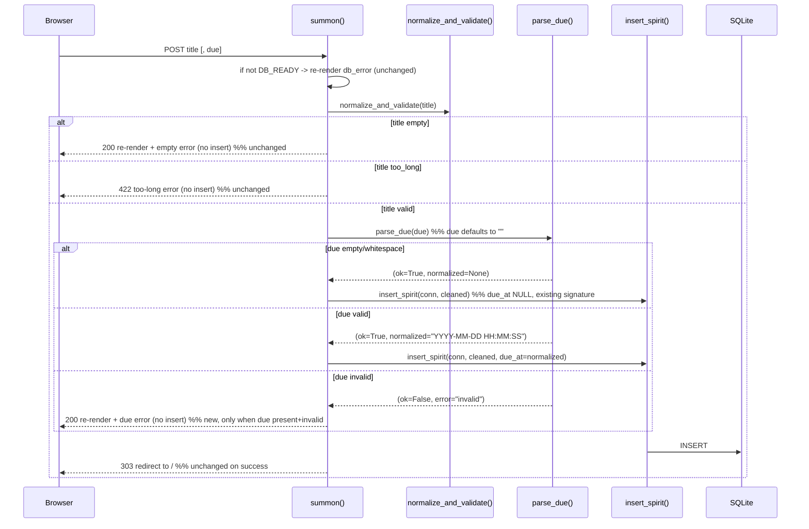

# Design Document

## Overview

The **poltergeist-due-dates** feature adds an optional due date (with optional time) to each summoned task and makes the whole Séance page "haunt" more intensely as deadlines approach and pass. The intensity is a single integer **haunting level** in `{0, 1, 2, 3}` derived purely from task due timestamps and a reference instant `now`.

The feature is designed as three cooperating layers, each mirroring an existing pattern in the codebase:

1. **Backend (Python / FastAPI / SQLite — `main.py`)**: a strictly additive `due` form field on `POST /summon`, a pure `parse_due()` function, an idempotent `due_at` column migration inside `init_db()` that copies the existing `created_at` migration shape, and additive extensions to the repository functions that preserve every existing signature.
2. **Pure JS core (`static/haunt.js`)**: a new UMD module following `static/age.js` exactly. It exports a pure, total `hauntingLevel(tasks, now)` plus threshold constants, mirrors `age.js`'s `parseCreated` date parsing, and auto-wires a defensive DOM adapter `applyHaunting(root, now)` in the browser. It signals the ghost mascot through a new, additive "worried" mood on `static/ghost.js`.
3. **Presentation (`templates/index.html` + inline CSS)**: optional date/time inputs on the summon form, a gothic "Haunting level" gauge with a visible text label and a polite ARIA live region, a page-level `data-haunt` level attribute driving candle flicker, a faint red vignette, intermittent board tremble, and overdue card shake+glow with a non-color indicator — all motion disabled under `prefers-reduced-motion`.

Everything that drives a haunting decision is a pure, injectable-time function, so the cores are verifiable with fast-check (JS) and Hypothesis (Python). The due field is additive: a request sending only `title` is byte-for-byte identical to today's behavior, and the entire existing test suite (`tests/*.prop.test.js`, `tests/test_*.py`) must keep passing unmodified.

### Design goals and non-goals

- **Goal**: zero behavior change for requests without a due value (R2, R8).
- **Goal**: a safe, re-runnable, non-destructive schema migration (R3).
- **Goal**: pure, clock-free cores importable under Node and pytest without the production DB (R4, R5, R9).
- **Goal**: accessible, non-color-only, reduced-motion-safe presentation (R7).
- **Non-goal**: editing a due date after creation, recurring tasks, timezones beyond the stored-string convention, or server-driven haunting (the level is computed client-side from rendered `data-due`).

## Architecture

```mermaid
flowchart TD
    subgraph Browser
        HTML["index.html form + task list (li[data-due]) + gauge"]
        HAUNT["static/haunt.js (pure core + DOM adapter)"]
        GHOST["static/ghost.js (+ additive 'worried' mood)"]
        CSS["inline CSS: data-haunt level reactions, @media reduced-motion"]
        HTML -->|reads li[data-due]| HAUNT
        HAUNT -->|hauntingLevel(tasks, now)| HAUNT
        HAUNT -->|set data-haunt + gauge text + aria-live| HTML
        HAUNT -->|worry signal| GHOST
        HTML --> CSS
    end

    subgraph Server["main.py (FastAPI)"]
        SUMMON["POST /summon (title + optional due)"]
        PARSE["parse_due(raw) -> (ok, normalized, error)"]
        REPO["list_spirits / insert_spirit / delete_spirit / normalize_and_validate"]
        INIT["init_db(): created_at migration + NEW due_at migration"]
    end

    DB[("SQLite tasks: id, title, created_at, due_at")]

    HTML -->|POST title[, due]| SUMMON
    SUMMON --> PARSE
    SUMMON --> REPO
    REPO --> DB
    INIT --> DB
    DB -->|rows incl. due_at| REPO
    REPO -->|tasks incl. due_at| HTML
```

### Request flow for `POST /summon`



The due branch is reached **only after** the existing title validation succeeds and **only when a non-empty due value is submitted**. When `due` is empty (the default), the flow is identical to today's code path, so all existing behaviors and tests are preserved (R2, R8).

### Client-side haunting flow

On `DOMContentLoaded` (and after a banish removes a card, reusing the existing adapter pattern), `applyHaunting(document, Date.now())`:

1. Collects `<li data-due>` cards and reads each `data-due` string.
2. Computes `level = hauntingLevel(tasks, now)` using the pure core.
3. Sets `data-haunt="<level>"` on `<body>` (or `<main>`), updates the gauge's visible text and its polite live region, and marks each overdue card with a class plus a non-color text/shape indicator.
4. Signals the ghost mascot: `level >= 2` -> worried; `level <= 1` -> non-worried.

The adapter is fully defensive (guarded by `typeof document !== "undefined"`), so `require("../static/haunt.js")` under Node runs no DOM code — identical to `age.js`.

## Components and Interfaces

### 1. `parse_due(raw)` — pure Python due parser (`main.py`)

```python
def parse_due(raw):
    """Pure. Returns (ok: bool, normalized: str | None, error: str | None).

    - raw empty / whitespace-only / None -> (True, None, None)   # "no due"
    - valid date-only            -> (True, "YYYY-MM-DD 23:59:59", None)
    - valid date + time          -> (True, "YYYY-MM-DD HH:MM:SS", None)
    - unparseable format         -> (False, None, "unparseable")
    - well-formed but impossible  -> (False, None, "invalid")   # e.g. 2023-02-30
    No system clock, no env, no I/O, no side effects.
    """
```

**Accepted input formats** (vanilla HTML, no libraries):

- `"YYYY-MM-DD"` — the value of an `<input type="date">`.
- `"YYYY-MM-DDTHH:MM"` or `"YYYY-MM-DDTHH:MM:SS"` — the value of an `<input type="datetime-local">`, or an ISO-like string.
- `"YYYY-MM-DD HH:MM:SS"` — the stored normalized form (space separator). Accepting this guarantees the round-trip property (R4.6): feeding a prior output back yields the same output.

**Chosen UI control: two separate inputs — `<input type="date" name="due">` plus an optional `<input type="time" name="due_time">`.**

Rationale: `<input type="date">` returns a clean `YYYY-MM-DD` and `<input type="time">` returns `HH:MM`, both widely supported with no libraries. The server concatenates them: if only the date is present, `parse_due` applies the end-of-day rule; if both are present, the handler joins them as `"YYYY-MM-DD HH:MM"` before parsing. A single `<input type="datetime-local">` was considered but rejected because it couples "date without time" into one field, making the end-of-day rule (R1.6) harder to express at the UI layer; two fields map cleanly onto the date-only vs date+time branches. `parse_due` still accepts the combined `YYYY-MM-DDTHH:MM` form so the control choice stays decoupled from the parser.

**Stored string format: `"YYYY-MM-DD HH:MM:SS"`** (SQLite-style, space separator) to match the existing `created_at` convention (`datetime('now')`) and so the JS `parseCreated`-style parser can read it the same way it reads `created_at`.

**Normalization rules**:

- Strip leading/trailing whitespace first.
- Date-only -> seconds component is forced to `23:59:59` of that calendar day (R1.6, R4.2) — deterministic end of day.
- Date+time -> preserve the supplied Y/M/D/H/M/S; if seconds are omitted by the control (`HH:MM`), append `:00` without otherwise altering the time (R4.3).
- Validity is checked by constructing a `datetime.datetime(...)` (or `datetime.date(...)`) from the parsed integer fields; a `ValueError` from an impossible calendar value (e.g. month 13, Feb 30) maps to `error="invalid"` (R4.5). A string that does not match any accepted shape maps to `error="unparseable"` (R4.4). Purity is kept by never calling `datetime.now()`/`today()` (R4.7).

### 2. `init_db()` — additive `due_at` migration (`main.py`)

The migration is inserted **immediately after** the existing `created_at` migration, inside the same `with closing(get_db()) as conn:` block and the same `try/except sqlite3.Error:` that governs `DB_READY`. It copies the `created_at` shape exactly:

```python
cols = [r[1] for r in conn.execute("PRAGMA table_info(tasks)").fetchall()]
if "created_at" not in cols:
    conn.execute("ALTER TABLE tasks ADD COLUMN created_at TEXT")
if "due_at" not in cols:                                   # NEW, same shape
    conn.execute("ALTER TABLE tasks ADD COLUMN due_at TEXT")
conn.commit()
```

- `PRAGMA table_info(tasks)` is read **before** any schema change (R3.1); `cols` is already read for `created_at` and is reused.
- `ALTER TABLE tasks ADD COLUMN due_at TEXT` has **no DEFAULT clause** (R3.2), so existing rows get `due_at = NULL` while `id`, `title`, `created_at` are untouched (R3.3).
- If `due_at` already exists, no ALTER runs and existing `due_at` values are byte-for-byte unchanged (R3.4).
- No DROP/DELETE/UPDATE/TRUNCATE is ever issued (R3.5).
- Running `init_db()` N>=2 times leaves exactly one `due_at` column (R3.6) — the `if "due_at" not in cols` guard is the idempotence point.
- A failing ALTER raises `sqlite3.Error`, caught by the existing `except`, which sets `DB_READY = False` and leaves rows unchanged because the ALTER is the only statement that could fail and SQLite ADD COLUMN does not rewrite existing row data (R3.7). The failure still propagates to the module-level `DB_READY` flag that callers consult.

> Note: `init_db()` already swallows `sqlite3.Error` to drive graceful degradation via `DB_READY`. R3.7 ("propagate the failure to the caller") is satisfied by that existing contract: the caller observes failure through `DB_READY = False`, exactly as the `created_at` migration behaves today. The design intentionally preserves this existing error-handling shape rather than changing `init_db()` to re-raise, which would break the current degradation behavior and existing tests (R8.2).

### 3. Repository functions — additive extensions (`main.py`)

All existing signatures are preserved for existing callers (R8.4, R8.5).

```python
def insert_spirit(conn, title: str, due_at: str | None = None) -> int:
    # Existing callers: insert_spirit(conn, cleaned) -> due_at stays None (NULL).
    # When due_at is None, INSERT only (title) exactly as today, so the column
    # defaults to NULL and the stored row is identical to the pre-feature row.
    if due_at is None:
        cursor = conn.execute("INSERT INTO tasks (title) VALUES (?)", (title,))
    else:
        cursor = conn.execute(
            "INSERT INTO tasks (title, due_at) VALUES (?, ?)", (title, due_at)
        )
    conn.commit()
    return cursor.lastrowid
```

```python
def list_spirits(conn) -> list[dict]:
    # Signature UNCHANGED. Extend the SELECT to include due_at WHEN the column
    # exists, mirroring the created_at handling already present. When due_at is
    # absent (old/test schemas), return due_at=None so dict shape stays stable.
    cols = [r[1] for r in conn.execute("PRAGMA table_info(tasks)").fetchall()]
    has_created = "created_at" in cols
    has_due = "due_at" in cols
    # Build SELECT column list from whichever optional columns are present;
    # fill missing ones with None via dict(row, created_at=None, due_at=None).
```

- `list_spirits` keeps returning newest-first (`ORDER BY id DESC`) and keeps including `created_at`; it now also includes `due_at` (or `None` when the column is absent, mirroring the existing `created_at` fallback). Existing callers/tests that only read `id`/`title`/`created_at` are unaffected because extra dict keys do not change their assertions (R8.4, R8.5).
- `delete_spirit(conn, task_id)` and `normalize_and_validate(raw_title)` are **unchanged** (R8.4).

### 4. `summon()` handler — additive `due` field (`main.py`)

```python
@app.post("/summon")
def summon(request: Request, title: str = Form(...), due: str = Form(""), due_time: str = Form("")):
    # due/due_time default to "" so a request sending ONLY title is unchanged (R2.5).
    # 1. DB_READY short-circuit: unchanged.
    # 2. normalize_and_validate(title): unchanged. empty -> 200 re-render; too_long -> 422.
    # 3. Title valid -> combine date+time, parse_due, then insert.
```

Combination + parse (only on the valid-title path):

```python
raw_due = due.strip()
if raw_due and due_time.strip():
    raw_due = raw_due + " " + due_time.strip()   # "YYYY-MM-DD HH:MM"
ok, normalized, due_err = parse_due(raw_due)     # raw_due "" -> (True, None, None)
if not ok:
    # Only reachable when a non-empty due was supplied and rejected (R1.5).
    # Re-render at 200 with a due-specific error, no insert (mirrors empty-title path).
    return _render_index(request, tasks=<current>, error="The due date value is invalid.", db_error=..., title=title)
with closing(get_db()) as conn:
    insert_spirit(conn, cleaned, due_at=normalized)   # normalized None -> NULL
return RedirectResponse("/", status_code=303)
```

Key guarantees: when `due`/`due_time` are absent/empty, `raw_due == ""`, `parse_due` returns `(True, None, None)`, and `insert_spirit(conn, cleaned, due_at=None)` runs the same single-column INSERT as today, then the same 303 redirect (R2.1, R2.4, R2.6). The empty-title (200) and too-long (422) branches run before any due handling, so they are byte-for-byte unchanged (R2.2, R2.3).

### 5. `static/haunt.js` — pure haunting core + DOM adapter

UMD wrapper identical in shape to `age.js`:

```js
(function (root, factory) {
  var api = factory();
  if (typeof module === "object" && module.exports) { module.exports = api; }
  if (root) { root.Haunt = api; }
})(typeof window !== "undefined" ? window : (typeof globalThis !== "undefined" ? globalThis : this), function () {
  "use strict";
  var SOON_MS = 24 * 60 * 60 * 1000;   // Soon_Threshold = 24h (R5.2)
  var OVERDUE_LEVEL3_COUNT = 3;        // Overdue_Level3_Count (R5.8)

  function parseDue(raw) { /* mirror of age.js parseCreated */ }
  function hauntingLevel(tasks, now) { /* pure, total, returns {0,1,2,3} or invalid outcome */ }
  function applyHaunting(root, now) { /* browser-only DOM adapter, defensive */ }

  // auto-wire on DOMContentLoaded, guarded by typeof document !== "undefined"
  return {
    SOON_MS: SOON_MS,
    OVERDUE_LEVEL3_COUNT: OVERDUE_LEVEL3_COUNT,
    parseDue: parseDue,
    hauntingLevel: hauntingLevel,
    applyHaunting: applyHaunting,
  };
});
```

**`parseDue(raw)`** — mirrors `age.js parseCreated` exactly: `null`/`undefined`/`""` -> `null`; finite number -> treated as epoch-ms; string -> `trim()`, replace the first space with `"T"`, append `"Z"` if no timezone suffix matches `/[zZ]|[+\-]\d\d:?\d\d$/`, then `Date.parse`; `NaN` -> `null`. This makes stored `"YYYY-MM-DD HH:MM:SS"` due strings parse as UTC, consistent with how `created_at` is read.

**`hauntingLevel(tasks, now)`** — pure and total:

- If `now` is not a finite number -> return an **invalid-input outcome** (the constant `-1`, documented as "invalid input / baseline"), without reading the clock (R6.8, R9.6). The DOM adapter treats any level outside `{0,1,2,3}` as baseline (R6.8).
- `tasks` is an array of records each exposing a due value (string|number|null); the function reads `t.due` (and tolerates a bare string element). Each due is parsed with `parseDue`; `null`/unparseable dues are excluded entirely (R5.9, R9.6).
- `overdue` = count of tasks whose parsed due `< now` (strictly earlier, R5.3).
- `soon` = exists a task whose parsed due is in `[now, now + SOON_MS)` (half-open, R5.2).
- Decision (R5.4–R5.8):
  - no parseable due, or none overdue and none soon -> `0`
  - some soon, none overdue -> `1`
  - `1 <= overdue < 3` -> `2`
  - `overdue >= 3` -> `3`
- Always returns an integer in `{0,1,2,3}` for finite `now` (R5.10); monotonic non-decreasing as `now` advances for a fixed due set (R5.11); independent of task order (R5.12).

**`applyHaunting(root, now)`** — browser-only (guarded by `typeof document`), defensive like `applyAgeClasses`:

1. `scope.querySelectorAll("main ul li[data-due]")` -> build `tasks = [{ due }]` from each `data-due` attribute.
2. `level = hauntingLevel(tasks, now)`; `displayLevel = (level in {0,1,2,3}) ? level : 0` (R6.8).
3. Set `data-haunt="<displayLevel>"` on `document.body` (CSS hook).
4. Update the gauge: `#haunting-gauge .haunting-level-text` textContent to a named state (see §Data Models), and the gauge's `aria-live="polite"` region (R7.1, R7.2, R7.6).
5. For each `li`: if its parsed due `< now`, add class `spirit-overdue` and set a `data-overdue="true"` plus inject/show a text/shape indicator ("⚠ overdue") so overdue is conveyed without color (R6.6, R7.5). Otherwise remove the overdue marking.
6. Mascot signal: `if (displayLevel >= 2) Ghost.worry(true); else Ghost.worry(false);` via `window.Ghost` if present (R6.7), fully guarded.

### 6. `static/ghost.js` — additive "worried" mood (no breaking change)

**Constraint discovered in the existing suite**: `tests/ghost.reactive.prop.test.js` asserts
`assert.deepStrictEqual(EXPRESSIONS, ["idle", "curious", "surprised", "happy", "sleepy"]);`
and Property 4 there asserts `isTransient` is true **only** for `surprised`/`happy`. Therefore the "worried" state **must not** be appended to `EXPRESSIONS`, `TRANSIENT`, or any structure those tests pin, or they would fail unmodified (violating R8.1/R8.2).

**Design**: add "worried" as a separate **mood overlay channel**, independent of the pinned `EXPRESSIONS` state machine:

- Add a new exported constant group that does **not** touch the asserted arrays:
  - `WORRIED_MOUTH` path (a downturned mouth `d`).
  - `WORRIED_PHRASES` array (>= 1 phrase, e.g. `"The deadlines draw near\u2026"`).
- Add a pure helper `moodForLevel(level)` returning `"worried"` for `level >= 2`, else `"calm"` — pure, total, exported for testing, and **not** part of `nextExpression`.
- Add a `worry(on)` method on the mascot object returned by `createMascot`. When `on` is true it applies a `expr-worried` class on `.ghost-svg` and rewrites `.ghost-mouth` to `WORRIED_MOUTH` (and may show a worried bubble); when false it restores the current base expression. This reuses the existing `applyExpression`-style DOM writing but as an additive overlay.
- Add `expr-worried` CSS (worried brow, downturned mouth) in `index.html`. Because `worry` writes a class/`d` directly and never calls `nextExpression`, and `moodForLevel`/`WORRIED_*` are new exports, the pinned assertions (`EXPRESSIONS`, `PHRASES`, `isTransient`, `nextExpression` transitions) remain exactly as the existing tests expect (R8.1).

> The existing `EXPRESSIONS`, `PHRASES`, `MOUTHS`, `nextExpression`, and `isTransient` are left byte-compatible with the current tests. "worried" lives alongside them, not inside them. This is the single most important compatibility decision in the feature.

### 7. `templates/index.html` + inline CSS

- **Summon form** (additive, English labels):
  - `<label for="summon-due">Due date (optional)</label><input id="summon-due" type="date" name="due">`
  - `<label for="summon-due-time">Due time (optional)</label><input id="summon-due-time" type="time" name="due_time">`
  - Both optional; omitting them submits only `title` (R1.1, R1.2, R2.5). Helper text in English (R1.7, R7-English).
- **Haunting gauge** (gothic, text-first, accessible):
  ```html
  <div id="haunting-gauge" class="haunting-gauge" role="status" aria-live="polite">
    <span class="haunting-gauge-label">Haunting level:</span>
    <span class="haunting-level-text">Calm (0)</span>
  </div>
  ```
  The visible text names the state (R7.1); the live region announces changes within 1s (R7.2); if the live region is unavailable, the visible text still shows the level (R7.6).
- **Page-level reaction**: JS sets `data-haunt` on `<body>`. CSS keys off it:
  - `body[data-haunt="1|2|3"]` increase candle-flicker intensity via CSS custom properties, one distinct, visibly stronger step per level (R6.2). Reuse the existing `--glow`/`candle-flicker` machinery.
  - `body[data-haunt="2"]`/`[data-haunt="3"]` paint a fixed, `pointer-events:none`, `aria-hidden` red **vignette** overlay at `opacity <= 0.25`, larger at level 3 than level 2 (R6.3).
  - `body[data-haunt="2"]`/`[data-haunt="3"]` apply an **intermittent board tremble** on `.ouija`: a keyframe whose active phase is `<= 1s` within a cycle of `>= 3s` (e.g. `tremble 4s ...` with motion only in the first ~0.8s) (R6.4).
  - `body[data-haunt="0"]` / out-of-range -> baseline only: no vignette, no tremble, no overdue shake, calm mascot (R6.1, R6.8).
- **Overdue card**: `li.spirit-overdue` gets continuous shake + glow (R6.6) **and** a non-color indicator — a text/shape badge (e.g. `⚠ overdue`) injected by the adapter — so overdue is identifiable without color (R7.5). The `<li>` carries `data-due="{{ task.due_at|default('', true) }}"` so the adapter can detect overdue (R6.6).
- **Reduced motion**: the existing global rule
  `@media (prefers-reduced-motion: reduce) { *, *::before, *::after { animation: none !important; transition: none !important; } }`
  already disables every animation/transition. All new motion (tremble, overdue shake, flicker intensification, vignette pulse) is expressed **only** through `animation`/`transition`, so reduced motion leaves static styling + the text gauge only, with elements at their resting position (R7.3, R7.4). The vignette's static opacity and the gauge text remain as non-motion level indicators.

## Data Models

### SQLite `tasks` table (after migration)

| Column       | Type    | Notes                                                        |
|--------------|---------|--------------------------------------------------------------|
| `id`         | INTEGER | PRIMARY KEY AUTOINCREMENT (unchanged)                        |
| `title`      | TEXT    | NOT NULL CHECK(length<=200) (unchanged)                      |
| `created_at` | TEXT    | nullable; `datetime('now')` default on fresh schema (unchanged) |
| `due_at`     | TEXT    | **NEW**, nullable, no DEFAULT; `"YYYY-MM-DD HH:MM:SS"` or NULL |

### `parse_due` result (Python)

`(ok: bool, normalized: str | None, error: str | None)` — exactly one of:
`(True, None, None)` (no due), `(True, "YYYY-MM-DD HH:MM:SS", None)` (valid), `(False, None, "unparseable" | "invalid")` (rejected).

### Task record consumed by `hauntingLevel` (JS)

`{ due: string | number | null }` (the adapter builds these from `li[data-due]`). `due` strings use the stored `"YYYY-MM-DD HH:MM:SS"` form; numbers are epoch-ms; `null`/unparseable are excluded.

### Haunting level -> named state (gauge text, English)

| Level | Named state | Page reaction summary                              |
|-------|-------------|----------------------------------------------------|
| 0     | `Calm`      | baseline ambiance only                             |
| 1     | `Restless`  | stronger candle flicker                            |
| 2     | `Haunted`   | + red vignette (<=0.25) + intermittent board tremble |
| 3     | `Possessed` | strongest flicker + larger vignette + tremble      |
| invalid | treated as `Calm (0)` | baseline only (R6.8)                     |

### `moodForLevel` (JS, ghost.js)

`moodForLevel(level) -> "worried" | "calm"`: `"worried"` iff `level >= 2`, else `"calm"`. Pure and total.

## Correctness Properties

*A property is a characteristic or behavior that should hold true across all valid executions of a system — essentially, a formal statement about what the system should do. Properties serve as the bridge between human-readable specifications and machine-verifiable correctness guarantees.*

The following properties are the consolidated, non-redundant set derived from the acceptance-criteria prework. Properties 1–6 target the pure JS `hauntingLevel`/`moodForLevel` cores (fast-check). Properties 7–12 target the pure Python `parse_due` function and the `due_at` migration / persistence (Hypothesis). Purely presentational criteria (R6 visuals, R7 accessibility/reduced-motion rendering, R1.1/1.7 markup) are intentionally **not** encoded as properties; they are covered by example/DOM/CSS checks in the Testing Strategy.

### Property 1: Haunting level is total, bounded, and deterministic

*For all* arrays of task records (with arbitrary string/number/null/garbage due values) and *for all* finite numeric `now`, `hauntingLevel(tasks, now)` returns an integer in the set `{0, 1, 2, 3}`, never throws, and returns the identical value when called again with the same arguments (independent of the system clock).

**Validates: Requirements 5.1, 5.10, 9.1, 9.4**

### Property 2: Haunting level honours the exact thresholds

*For all* task due sets and finite `now`: if no task has a parseable due, or every parseable due is at or after `now + 24h`, the level is `0`; if at least one parseable due lies in `[now, now + 24h)` and none is strictly before `now`, the level is `1`; if the number of dues strictly before `now` is `1` or `2`, the level is `2`; if that count is `>= 3`, the level is `3`. (Soon_Threshold = 24h half-open; overdue = strictly before `now`; a due exactly equal to `now` is soon, not overdue.)

**Validates: Requirements 5.2, 5.3, 5.4, 5.5, 5.6, 5.7, 5.8**

### Property 3: NULL, missing, and unparseable dues contribute nothing

*For all* task due sets and finite `now`, inserting any number of tasks whose due is `null`, missing, or an unparseable string does not change the value of `hauntingLevel` computed for the remaining tasks.

**Validates: Requirements 5.9, 9.6**

### Property 4: Haunting level is non-decreasing in time

*For all* fixed task due sets and *for all* pairs `now1 <= now2` (both finite), `hauntingLevel(tasks, now1) <= hauntingLevel(tasks, now2)`.

**Validates: Requirements 5.11**

### Property 5: Haunting level is order-independent

*For all* task due sets and finite `now`, `hauntingLevel(tasks, now)` equals `hauntingLevel(permutation_of(tasks), now)` for every permutation of the tasks.

**Validates: Requirements 5.12**

### Property 6: Invalid `now` yields an invalid-input outcome without reading the clock

*For all* non-finite `now` values (`NaN`, `Infinity`, `-Infinity`, non-numbers) and all task due sets, `hauntingLevel(tasks, now)` returns the invalid-input outcome (a value outside `{0, 1, 2, 3}`) rather than a level, does not throw, and does not depend on `Date.now()`.

**Validates: Requirements 6.8, 9.6**

### Property 7: Ghost mood follows the level threshold

*For all* integer levels, `moodForLevel(level)` returns `"worried"` if and only if `level >= 2`, and `"calm"` otherwise.

**Validates: Requirements 6.7**

### Property 8: Empty or whitespace due is "no due", never an error

*For all* strings consisting only of whitespace characters (including the empty string), `parse_due` returns `(True, None, None)` — never a parse-error result.

**Validates: Requirements 4.1**

### Property 9: Date-only input normalizes to end of day

*For all* valid calendar dates supplied without a time component, `parse_due` returns `ok = True` and a normalized string equal to `"YYYY-MM-DD 23:59:59"` for that exact year, month, and day.

**Validates: Requirements 1.6, 4.2**

### Property 10: Date-with-time input preserves every component

*For all* valid calendar date-times supplied with a time component, `parse_due` returns `ok = True` and a normalized string that preserves the supplied year, month, day, hour, minute, and second unchanged.

**Validates: Requirements 4.3**

### Property 11: Invalid due input is rejected with no timestamp

*For all* non-empty inputs whose non-whitespace content either does not match any supported date/date-time shape or represents a non-existent calendar date or time, `parse_due` returns `ok = False` with `normalized = None`.

**Validates: Requirements 1.5, 4.4, 4.5**

### Property 12: Due normalization round-trips and is clock-independent

*For all* inputs that `parse_due` reports as valid, feeding the normalized output back into `parse_due` yields a normalized output equal to the first; and *for all* inputs, the result of `parse_due` is identical regardless of the system clock (it reads no clock, environment, or external state).

**Validates: Requirements 4.6, 4.7, 9.5**

### Property 13: The due_at migration preserves all data and is idempotent

*For all* seeded row sets (arbitrary `id`/`title`/`created_at`/`due_at` values) and *for all* run counts `N >= 1`, running the migration `N` times on the same database leaves the `tasks` table with exactly one `due_at` column and preserves every pre-existing row's `id`, `title`, `created_at`, and `due_at` byte-for-byte (rows added before the column existed have `due_at = NULL`).

**Validates: Requirements 3.3, 3.4, 3.5, 3.6**

### Property 14: due_at persistence round-trip (including the no-due case)

*For all* valid titles and *for all* due values that are either absent (`None`) or a valid normalized timestamp, `insert_spirit` followed by `list_spirits` returns a task whose `title` equals the inserted title and whose `due_at` equals the inserted due value (`None` -> stored and read back as NULL). The two-argument call `insert_spirit(conn, title)` stores `due_at` as NULL, identical to the pre-feature behaviour.

**Validates: Requirements 1.3, 1.4, 2.6, 8.4, 8.5**

## Error Handling

The feature extends the existing, proven error model rather than introducing a new one.

### Summon endpoint (`main.py`)

| Condition | Response | Persistence | Requirement |
|-----------|----------|-------------|-------------|
| `DB_READY` is False | re-render with `db_error=True` message (unchanged) | none | existing |
| Title empty after strip (any due) | 200 re-render, empty-title error, value kept | none | R2.2 |
| Title too long (any due) | HTTP 422, too-long error | none | R2.3 |
| Title valid, due empty/absent | 303 redirect to `/` | one row, `due_at` NULL | R2.4, R2.6 |
| Title valid, due valid | 303 redirect to `/` | one row, `due_at` = normalized | R1.4 |
| Title valid, due **present and invalid** | 200 re-render, due-specific error, no insert | none | R1.5 |

The due error branch mirrors the empty-title re-render (same 200 status, same `_render_index` path, value preserved) and is reached **only** when a non-empty due value fails `parse_due`. Title validation always runs first, so title errors take precedence and remain byte-for-byte identical to today (R2.1, R8.3).

### `parse_due` (pure)

Returns a result tuple instead of raising: `(False, None, "unparseable")` for shape mismatches, `(False, None, "invalid")` for impossible calendar values. It never raises for bad input and never reads the clock, so callers branch on `ok` (R4.4, R4.5, R4.7). Internally, impossible dates are detected by catching `ValueError` from `datetime` construction and converting it to `ok = False` — the exception never escapes.

### `init_db` migration

Preserves the existing `try/except sqlite3.Error` that drives `DB_READY`. A failing `ALTER TABLE ... ADD COLUMN due_at` is caught, sets `DB_READY = False`, and leaves existing rows untouched (ADD COLUMN does not rewrite row data). Callers observe failure through `DB_READY`, exactly as the `created_at` migration already behaves (R3.7). The design deliberately does not change this to re-raise, because that would alter the current graceful-degradation contract and could break existing tests (R8.2).

### JS cores (`haunt.js`)

`hauntingLevel` and `parseDue` are total: non-finite `now` -> invalid-input outcome (never a level, never a throw); null/unparseable dues are silently excluded. The DOM adapter `applyHaunting` is fully defensive (guards on `typeof document`, `querySelectorAll`, `classList`, `getAttribute`) so it never throws and is inert under Node — identical to `applyAgeClasses` in `age.js`. Any level outside `{0,1,2,3}` is clamped to baseline (0) for presentation (R6.8). The `window.Ghost.worry` call is guarded so a missing or older `ghost.js` cannot break haunting.

## Testing Strategy

### Dual approach

- **Property tests** verify the universal properties above across many generated inputs.
- **Example / DOM / CSS / integration tests** verify specific behaviors, presentation, accessibility, reduced motion, and backward compatibility.

Both are necessary: property tests cover the pure cores comprehensively; example and integration tests cover presentation and the HTTP contract.

### Property-based testing applicability

PBT **applies** to the two pure cores — `hauntingLevel`/`moodForLevel` (timestamp logic) and `parse_due` (date normalization/parsing, a classic parse/normalize round-trip) — and to the data-preservation/idempotence invariants of the migration and persistence. PBT **does not apply** to the R6 visual reactions, the R7 accessibility/reduced-motion rendering, or the R1.1/R1.7 markup; those are deterministic presentation, tested by example/DOM/CSS review (snapshot-style) instead.

### JS property tests — `tests/haunt.prop.test.js` (new)

Conventions copied from `tests/age.prop.test.js`: `node:test` runner, `fast-check`, `require("../static/haunt.js")`, `{ numRuns: 200 }` (>= 100), each test tagged `Feature: poltergeist-due-dates, Property N: ...`. The file imports only the pure core; no DOM, DB, or network (the adapter is inert under Node, proving R9.2). Generators: arbitrary task due arrays mixing valid `"YYYY-MM-DD HH:MM:SS"` strings, epoch-ms numbers, `null`/`undefined`/`""`/garbage; and `now` as finite integers/doubles (plus `NaN`/`±Infinity` for the invalid-input property). Tests:

- **Property 1** — totality/bounded/determinism: finite `now`, arbitrary tasks -> result in `{0,1,2,3}`, `assert.doesNotThrow`, and two calls equal.
- **Property 2** — exact thresholds: construct controlled due sets relative to `now` (soon=24h -> 1; 1–2 overdue -> 2; >=3 overdue -> 3; none -> 0) plus explicit boundary examples (`due == now` is soon not overdue; `now + SOON_MS` exclusive).
- **Property 3** — exclusion: injecting null/garbage dues leaves the level unchanged.
- **Property 4** — monotonicity: `now1 <= now2` -> `level(now1) <= level(now2)` for a fixed due set.
- **Property 5** — order independence: `level(tasks) == level(shuffle(tasks))`.
- **Property 6** — invalid `now`: non-finite `now` -> invalid-input sentinel (outside `{0,1,2,3}`), no throw.
- **Property 7** — `moodForLevel(level) === "worried"` iff `level >= 2`.

### Python property tests — `tests/test_prop_due.py` (new)

Conventions copied from `tests/test_prop_summon_valid.py`: `pytest` + `hypothesis`, `@settings(max_examples=200, deadline=None)`, `import main`, each test docstring tagged `Feature: poltergeist-due-dates, Property N`. A `temp_db()` context manager (as in the existing file) creates an isolated temp SQLite file — the production `db.sqlite3` is never touched (R9.3). Tests:

- **Property 8** — whitespace/empty -> `(True, None, None)`.
- **Property 9** — valid dates (Hypothesis `st.dates()`) -> `"YYYY-MM-DD 23:59:59"`.
- **Property 10** — valid date-times (`st.datetimes()`) -> components preserved.
- **Property 11** — malformed strings and impossible components -> `ok = False`, `normalized = None`.
- **Property 12** — round-trip (`parse_due(normalized) == normalized`) and clock-independence (results identical even when `datetime.now`/`date.today` are monkeypatched to a wild value, proving no clock read).
- **Property 13** — migration: seed arbitrary rows in a temp DB, run the migration `N >= 1` times, assert the row multiset (`id`/`title`/`created_at`/`due_at`) is preserved and exactly one `due_at` column exists.
- **Property 14** — persistence round-trip: for valid titles and `None`-or-valid due, `insert_spirit` then `list_spirits` returns matching `title` and `due_at`; the two-arg call stores NULL.

### Example / DOM / CSS / integration tests

- **Template examples** (pytest + FastAPI `TestClient`): `GET /` renders the optional date/time inputs with English labels (R1.1, R1.7); the gauge element with visible text + `aria-live="polite"` is present (R7.1); each `<li>` carries `data-due` (R6.6).
- **Backward-compat integration** (pytest, temp DB): `POST /summon` with only `title` -> 303 and one row with `due_at` NULL (R2.1, R2.4, R2.5, R8.3); empty title -> 200 + empty error (R2.2); >200 chars -> 422 (R2.3); `POST /banish/{id}` and `GET /` without due unchanged (R8.3). Present-but-invalid due -> 200 re-render with due error, no insert (R1.5).
- **Migration edge case** (R3.7): with a connection whose `execute` is monkeypatched to raise on the `due_at` ALTER, assert rows are unchanged and failure is observable via `DB_READY`.
- **CSS / DOM review** (documented assertions, snapshot-style): `data-haunt` levels 1/2/3 produce distinct, increasing flicker (R6.2); vignette opacity `<= 0.25`, larger at 3 (R6.3); tremble active phase `<= 1s` within a `>= 3s` cycle (R6.4); overdue card gets shake+glow and a text/shape indicator (R6.6, R7.5); the global `@media (prefers-reduced-motion: reduce)` rule disables all new animation/transition, leaving static styling + gauge text (R7.3, R7.4); gauge named-state text present (R6.5, R7.1); live-region fallback keeps the visible text (R7.6).
- **Mascot compatibility** (JS, node:test): adding the "worried" mood must keep the existing `tests/ghost.reactive.prop.test.js` green — in particular `EXPRESSIONS` stays `["idle","curious","surprised","happy","sleepy"]` and `isTransient` stays true only for `surprised`/`happy`. A small new assertion confirms `moodForLevel` and the `WORRIED_*` exports exist without altering the pinned structures.

### Existing-suite preservation gate (R8.1, R8.2)

The full existing suite must pass **unmodified**: all `tests/*.prop.test.js` under `node --test "tests/**/*.test.js"` and all `tests/test_*.py` under `pytest`, including the ghost tests after the additive "worried" mood. No existing test file may be edited; if any would need editing, the implementation is non-compliant and must change instead. Run both suites as the final verification step.

### Property test configuration summary

- Library: `fast-check` (JS, already a devDependency), `hypothesis` (Python, already used).
- Iterations: `>= 100` (JS uses `{ numRuns: 200 }`; Python uses `max_examples=200`, `deadline=None`).
- Tag format on every property test: `Feature: poltergeist-due-dates, Property {number}: {property_text}`.
- Each correctness property above is implemented by a single property-based test.

## Requirements Traceability

| Design component | Requirements satisfied |
|------------------|------------------------|
| Optional `due`/`due_time` form inputs + English labels (index.html) | R1.1, R1.2, R1.7, R2.5 |
| `parse_due` pure parser (empty, date-only, datetime, invalid, round-trip, purity) | R1.5, R1.6, R4.1, R4.2, R4.3, R4.4, R4.5, R4.6, R4.7, R9.3, R9.5 |
| `summon()` additive due handling (default `""`, parse, insert, error branch) | R1.3, R1.4, R1.5, R2.1, R2.2, R2.3, R2.4, R2.5, R2.6, R8.3 |
| `init_db()` `due_at` migration (PRAGMA guard, no-DEFAULT ADD COLUMN, idempotent, non-destructive, DB_READY on failure) | R3.1, R3.2, R3.3, R3.4, R3.5, R3.6, R3.7 |
| `insert_spirit(conn, title, due_at=None)` additive param | R1.3, R1.4, R2.6, R8.4, R8.5 |
| `list_spirits` extended SELECT with due_at + None fallback (signature unchanged) | R8.4, R8.5 |
| `delete_spirit` / `normalize_and_validate` unchanged | R8.4, R8.5 |
| `hauntingLevel(tasks, now)` pure core + `parseDue` + thresholds `SOON_MS`/`OVERDUE_LEVEL3_COUNT` | R5.1–R5.12, R9.1, R9.2, R9.4, R9.6 |
| `applyHaunting(root, now)` DOM adapter (data-haunt, gauge, overdue marking, clamp, mascot signal) | R6.1, R6.5, R6.6, R6.7, R6.8, R7.1, R7.2, R7.5, R7.6 |
| `moodForLevel` + additive `worry()`/`WORRIED_*` on ghost.js (no change to EXPRESSIONS) | R6.7, R8.1 |
| Gauge markup (visible text + aria-live) | R6.5, R7.1, R7.2, R7.6 |
| `data-haunt` CSS: flicker, vignette, tremble, baseline | R6.1, R6.2, R6.3, R6.4, R6.8 |
| Overdue card shake+glow + text/shape indicator; `li[data-due]` | R6.6, R7.5 |
| Global `@media (prefers-reduced-motion: reduce)` coverage of all new motion | R7.3, R7.4 |
| `tests/haunt.prop.test.js` (Properties 1–7) | R5.1–R5.12, R6.7, R6.8, R9.1, R9.2, R9.4, R9.6 |
| `tests/test_prop_due.py` (Properties 8–14) | R1.3, R1.4, R1.6, R2.6, R3.3, R3.4, R3.5, R3.6, R4.1–R4.7, R8.4, R8.5, R9.3, R9.5 |
| Example/DOM/CSS/integration tests | R1.1, R1.5, R1.7, R2.1, R2.2, R2.3, R2.4, R2.5, R3.7, R6.1–R6.6, R7.1–R7.6, R8.3 |
| Existing-suite preservation gate | R8.1, R8.2 |
