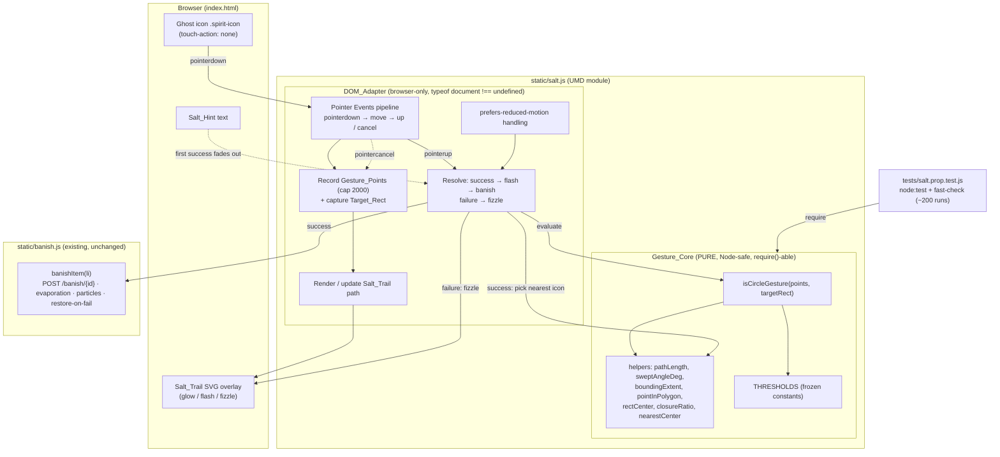

# Design Document

## Overview

The salt-circle-banish feature adds a gesture-based way to banish a task: the user presses on a task card's ghost icon and drags a closed loop ("salt circle") around it. A glowing white SVG salt trail follows the pointer while dragging. On release, a **pure** geometry function classifies the recorded path as a circle (or not). A successful circle flashes, then banishes the enclosed task through the **existing** banish flow; a failed gesture fizzles out and leaves the task untouched.

The feature is a single new vanilla JS module, `static/salt.js`, built with the same two-layer UMD pattern already used by `static/board.js` and `static/banish.js`:

- A **pure `Gesture_Core`** — no DOM, no network, Node-safe, frozen constants — exporting `isCircleGesture(points, targetRect)` and named geometry helpers. This is the `require()`-able, property-tested layer.
- A **browser-only `DOM_Adapter`** — guarded by `typeof document !== "undefined"` — that wires Pointer Events, renders the salt trail, runs the flash/fizzle animations, manages the one-time hint, applies `touch-action: none` to the ghost icon only, honors `prefers-reduced-motion`, and **delegates the actual banish to `window.Banish.banishItem`**.

The server contract is unchanged: there is **no new request path**. Success reuses `banishItem(li)` from `banish.js`, which already performs the single `POST /banish/{id}`, the 400 ms evaporation animation (`ANIMATION_MS`), the card particles, and the restore-on-failure handling. The existing Banish button, Enter, and Space remain fully functional accessible fallbacks. No file under `main.py` or `tests/` is modified; a single new test file `tests/salt.prop.test.js` is added for the pure core.

### Research and grounding

Key findings from the existing codebase that shape this design:

- **UMD two-layer pattern** (`board.js`, `banish.js`): an IIFE `(function (root, factory) { ... })` exports `module.exports` for Node **and** a browser global (`window.Salt`). The factory returns a plain object of named exports. All DOM access sits behind `typeof document !== "undefined"`, and pure logic is exported for tests. `salt.js` mirrors this exactly.
- **`banish.js` public API** (returned object): `banishItem(li, opts)` (the entry point we reuse), `restoreAtIndex`, `restoreElementToList`, `ANIMATION_MS` (= 400), `spawnCardParticles` (private but invoked inside `banishItem`), `showBanishError`, `prefersReducedMotion()` helper pattern. `banishItem` already reads `data-id` from the `<li>`, plays the `.banished` animation, sends exactly one `POST /banish/{id}`, and on non-2xx/network error restores the card to its original index and shows the error. We call `banishItem` and add **no** divergent failure handling.
- **`banish.js` auto-init**: it binds `form.banish-form` submit and a hold-to-banish pointer gesture on the button on `DOMContentLoaded`. `salt.js` must **not** interfere with those bindings and must **not** auto-init under Node.
- **Template markup** (`templates/index.html`): each task is `<li data-id="..."><div class="spirit"><svg class="spirit-icon">…</svg><span class="spirit-name">…</span></div><form class="banish-form"><button type="submit">…</button></form></li>`. The ghost icon is `.spirit-icon` (an inline SVG). CSS conventions: theme variables `--glow` (#ffb347), `--spirit` (#b9a6ff); particle effects use radial-gradient dots; a **global** `@media (prefers-reduced-motion: reduce)` rule forces `animation: none !important`, so motion-only effects are neutralized by that single rule when they rely solely on `animation`.
- **Test conventions** (`board.geom.prop.test.js`, `package.json`): CommonJS; runner is `node --test "tests/**/*.test.js"`; PBT library is `fast-check@^4` (`const fc = require("fast-check")`); modules are imported with `require("../static/...")`; ~200 `numRuns` per property; tests are pure and Node-only (no DOM, no network), relying on the module's `typeof document` guards so `require()` has no side effects.

## Architecture

`salt.js` is loaded in `index.html` with a plain `<script src="/static/salt.js"></script>` **after** `banish.js`, so `window.Banish.banishItem` exists when the adapter runs. No build step; vanilla JS/CSS/inline-SVG only.



### Layering inside salt.js

Following `board.js`/`banish.js`, the module body is organized top-to-bottom as:

1. UMD wrapper + `"use strict"`.
2. **Frozen `THRESHOLDS`** constants (public, exported — like `geom` in `board.js`).
3. **Pure core**: geometry helpers, then `isCircleGesture`, then the pure `nearestCenter` target-selection helper. No DOM, no network, no mutation of arguments, totally defined (never throws).
4. **Browser-only adapter**: `prefersReducedMotion()`, trail rendering, the Pointer Events wiring, success/failure resolution, hint management, and `init(scope)`.
5. Auto-init **only** inside `typeof document !== "undefined"` (on `DOMContentLoaded`), exactly like `banish.js`. Under Node `require()`, nothing runs.
6. `return { THRESHOLDS, isCircleGesture, pathLength, sweptAngleDeg, boundingExtent, pointInPolygon, enclosesPoint, rectCenter, closureRatio, nearestCenter, init }`.

## Components and Interfaces

### Gesture_Core (pure, Node-safe)

All helpers are pure (no DOM, no network, no argument mutation), **total** (never throw for any input, including `null`/`undefined`/`NaN`/`Infinity`/non-arrays), and **finite-safe** (return a well-defined finite number or a safe default rather than `NaN`/`Infinity` leaking into the boolean decision).

| Export | Signature | Input | Output | Purity / Totality |
| --- | --- | --- | --- | --- |
| `isCircleGesture` | `isCircleGesture(points, targetRect) → boolean` | `points`: array of `{x,y}`; `targetRect`: `{left,top,width,height}` | `true` iff the gesture qualifies as a circle enclosing the target center, else `false` | Pure, total: any malformed input returns `false` without throwing. No DOM/network. |
| `pathLength` | `pathLength(points) → number` | array of `{x,y}` | sum of Euclidean distances between consecutive points; `0` for `< 2` points | Pure, total, finite (returns `0` on degenerate/non-finite input). |
| `sweptAngleDeg` | `sweptAngleDeg(points, center) → number` | points + `{x,y}` center | signed cumulative turn in **degrees** around `center` (sum of per-segment signed angle deltas, each normalized to `(-180, 180]`) | Pure, total, finite (returns `0` on degenerate input). |
| `boundingExtent` | `boundingExtent(points) → {width, height}` | array of `{x,y}` | axis-aligned bounding box size of the points | Pure, total; `{width:0, height:0}` on empty/degenerate input. |
| `pointInPolygon` | `pointInPolygon(point, polygon) → boolean` | `{x,y}` + array of `{x,y}` | `true` iff `point` is inside the closed polygon (ray-casting) | Pure, total; `false` on `< 3` vertices or malformed input. |
| `enclosesPoint` | `enclosesPoint(points, point) → boolean` | gesture points + target point | alias/wrapper of `pointInPolygon(point, points)` for readability | Pure, total. |
| `rectCenter` | `rectCenter(rect) → {x, y}` | `{left,top,width,height}` | `{x: left + width/2, y: top + height/2}` | Pure, total; coordinates finite when the rect fields are finite. |
| `closureRatio` | `closureRatio(points) → number` | array of `{x,y}` | `distance(firstPoint, lastPoint) / pathLength(points)`; `1` when path length is `0` (treated as open/degenerate) | Pure, total, finite in `[0, …]`. |
| `nearestCenter` | `nearestCenter(center, candidates) → {x,y}|null` | `{x,y}` + array of `{x,y}` | the candidate minimizing Euclidean distance to `center`; `null` for empty/malformed candidates | Pure, total. Used by the adapter to pick which enclosed icon to banish. |

#### `isCircleGesture` decision procedure

The function returns `true` only when **all** of the following hold (each comes directly from Requirement 3). Any failing check returns `false`; malformed input short-circuits to `false`.

1. **Validity (Req 3.10, 3.8):** `points` is an array with **≥ 8** entries and each used entry has finite numeric `x`/`y`; `targetRect` is a non-null object with finite `left/top/width/height`. Otherwise return `false` (no throw).
2. **Bounding extent (Req 3.9):** `boundingExtent(points)` has `width ≥ 20` **and** `height ≥ 20` px. Otherwise `false`.
3. **Closure (Req 3.6):** `closureRatio(points) ≤ 0.20` — the straight-line distance between the start and end points is at most 20% of the total path length. Otherwise `false`.
4. **Enclosure (Req 3.7):** `enclosesPoint(points, rectCenter(targetRect))` is `true` (ray-casting point-in-polygon with the gesture path as the polygon). Otherwise `false`.
5. **Swept angle (Req 3.4, 3.5):** `Math.abs(sweptAngleDeg(points, rectCenter(targetRect))) ≥ 300`. Otherwise `false`.

When all five pass, return `true` (Req 3.4).

**Swept-angle accumulation.** `sweptAngleDeg` treats the target center `C` as the origin. For each consecutive pair of gesture points `Pᵢ, Pᵢ₊₁`, compute the angle of each relative to `C` (`atan2(Pᵢ.y − C.y, Pᵢ.x − C.x)`), take the delta `θᵢ₊₁ − θᵢ`, and **normalize that delta to `(-180, 180]`** so a step that crosses the ±180° seam is counted as the short way around (never a spurious ±360° jump). Summing these signed, normalized deltas yields the total signed turn around `C`. A full clockwise loop accumulates toward `+360`, a full counter-clockwise loop toward `−360`. Because the acceptance test compares `Math.abs(total)` to `300`, **both rotation directions pass** (Req 9.3) and an incomplete arc (e.g. a half loop ≈ 180°) is rejected (Req 3.5).

**Ray-casting enclosure test.** `pointInPolygon(point, polygon)` casts a horizontal ray from `point` to `+∞` and counts how many polygon edges it crosses. An odd count means the point is inside. The gesture path is used directly as the polygon (implicitly closed from last vertex back to first). This decides whether the loop actually surrounds the target center (Req 3.7) regardless of circle shape or direction. Fewer than 3 vertices → `false`.

### DOM_Adapter (browser-only)

Guarded entirely by `typeof document !== "undefined"`. Responsibilities and interfaces:

- **`prefersReducedMotion()`** — same defensive helper as `board.js`/`banish.js`: returns `false` when `window.matchMedia` is absent or throws.
- **`init(scope)`** — idempotent wiring (mirrors `banish.js init`). For each `li[data-id]` found under `scope` (default `document`), finds the ghost icon `.spirit-icon`, applies `touch-action: none` to **that icon only** (Req 6.1), and attaches pointer listeners. Marks processed cards with a `data-salt-bound="1"` attribute to avoid double-binding. Ensures a single shared SVG overlay layer exists for trails, and ensures the `Salt_Hint` element exists with its text.
- **Pointer Events pipeline** — on `pointerdown` on a ghost icon: record the press origin, capture the pointer (`setPointerCapture`), and store the icon's `Target_Rect` via `getBoundingClientRect()`. On `pointermove`: once movement exceeds **5 px** from origin (Req 2.1), begin recording; append each move position to `Gesture_Points` (capped at **2000**, dropping oldest — Req 2.3) and update the trail path (Req 2.4). On `pointerup`: stop recording and resolve (Req 2.6). On `pointercancel`/lost capture: discard points and remove the trail **without evaluating** (Req 2.7).
- **Trail rendering** — the `Salt_Trail` is an inline `<svg>` overlay positioned over the page (fixed, full-viewport, `pointer-events: none`) containing a single `<path>` whose `d` is rebuilt from the recorded points in viewport coordinates. Styled glowing white via `filter: drop-shadow(...)`. New trail replaces any in-progress fizzle (Req 5.4).
- **Resolution** — call `isCircleGesture(points, targetRect)`:
  - **Success:** collect all currently visible ghost-icon centers enclosed by the gesture polygon (`enclosesPoint`); if **exactly one**, flash then banish it; if **more than one**, use `nearestCenter(circleCenter, enclosedCenters)` to pick the single nearest icon and banish only its card (Req 4.5); if **zero**, just remove the trail (Req 4.4). The circle center is the centroid/bounding-box center of the gesture points. Banishing calls `window.Banish.banishItem(li)` after the flash completes (Req 4.1–4.3). First successful salt banish fades out the `Salt_Hint` (Req 7.6).
  - **Failure:** play the fizzle fade-out on the trail, then remove the trail element (Req 5.1–5.3); leave all cards untouched (Req 5.2).
- **Reduced motion** — when `prefersReducedMotion()` is active, the adapter skips drawing the animated trail/flash/fizzle and, on a successful circle, invokes `banishItem` directly so only the end result renders (Req 8). CSS also neutralizes trail/flash/fizzle via the global reduced-motion rule as a backstop.

### Integration with banish.js (no new server path)

- The adapter never constructs a `fetch` or a banish request. It calls `window.Banish.banishItem(li)` — the exact function the Banish button path uses — so the request is identically one `POST /banish/{id}` with `{id}` = the card's `data-id` (Req 1.2, 1.3).
- Failure after a successful gesture is handled **entirely** by `banishItem`: it restores the card to its original index and shows the error. The adapter adds no divergent failure handling (Req 1.4).
- `salt.js`'s `<script>` tag is added to `index.html` **after** `banish.js` so `window.Banish` is defined. `salt.js` does not rebind or modify the form submit / hold-to-banish handlers that `banish.js` owns; the accessible fallbacks remain intact (Req 7.1–7.3, 7.5).

## Data Models

```js
// A single recorded pointer sample (viewport coordinates, CSS pixels).
Gesture_Point = { x: number, y: number }

// Gesture_Points: an ordered array of Gesture_Point, capped at 2000 entries.
Gesture_Points = Gesture_Point[]

// Target_Rect: shape compatible with getBoundingClientRect() output AND with
// synthetic rects built in tests. Only these four fields are read.
Target_Rect = { left: number, top: number, width: number, height: number }
```

Thresholds are **frozen constants**, exported like `board.js`'s `geom`, so the core and tests share one source of truth and nothing can mutate them:

```js
var THRESHOLDS = Object.freeze({
  MIN_POINTS: 8,            // Req 3.8 — minimum Gesture_Points
  MAX_POINTS: 2000,         // Req 2.3 — recording cap (adapter)
  MIN_SWEPT_DEG: 300,       // Req 3.4/3.5 — minimum |swept angle| in degrees
  MAX_CLOSURE_RATIO: 0.20,  // Req 3.6 — start→end distance ≤ 20% of path length
  MIN_EXTENT_PX: 20,        // Req 3.9 — min bounding width AND height
  MOVE_START_PX: 5          // Req 2.1 — movement before recording begins (adapter)
});
```

## Correctness Properties

*A property is a characteristic or behavior that should hold true across all valid executions of a system — essentially, a formal statement about what the system should do. Properties serve as the bridge between human-readable specifications and machine-verifiable correctness guarantees.*

These executable properties apply to the **pure `Gesture_Core`** only: `isCircleGesture` and its helpers are pure functions over a large input space (arbitrary point lists and rects) with clear boolean/numeric outputs. The `DOM_Adapter` (Pointer Events, SVG rendering, flash/fizzle timing, hint, `touch-action`, reduced-motion, and the `banishItem` invocation) is browser-only side-effect orchestration; it is **not** property-tested — it is verified manually/by integration and by delegating the banish to the already-tested `banishItem`. These properties are implemented in the **new** file `tests/salt.prop.test.js` (existing tests are not modified).

### Property 1: `isCircleGesture` is pure and total for arbitrary input

*For all* inputs — including `null`/`undefined`, non-arrays, point arrays of any length (notably fewer than 8), entries with missing or non-finite `x`/`y`, and any `targetRect` (including `null`) — `isCircleGesture(points, targetRect)` returns a value of type `boolean`, never throws, and performs no DOM or network access. In particular, when `points` is `null`/`undefined` or has fewer than 8 entries, or when `targetRect` is `null`/`undefined`, the result is exactly `false`.

**Validates: Requirements 3.1, 3.8, 3.10**

### Property 2: A perfect circle enclosing the target center is accepted

*For all* target rects and all radii in `[20, 400]` px, a synthetic perfect circle of that radius centered on the target center, sampled with at least 8 evenly spaced points, is classified as a circle (`isCircleGesture` returns `true`).

**Validates: Requirements 3.4, 9.2**

### Property 3: Acceptance is independent of rotation direction

*For all* such perfect circles, the gesture is accepted whether its points are ordered clockwise or counter-clockwise (because the decision compares the **absolute** swept angle to 300°).

**Validates: Requirements 3.4, 9.3**

### Property 4: A straight line is rejected

*For all* straight-line gestures (points sampled along a segment, with at least 8 points), `isCircleGesture` returns `false` — the start→end distance equals the full path length (closure ratio ≈ 1 > 0.20) and the swept angle around any center is ≈ 0.

**Validates: Requirements 3.6, 9.4**

### Property 5: A partial arc is rejected

*For all* partial-arc gestures with at least 8 points whose absolute swept angle around the target center is below 300°, `isCircleGesture` returns `false`.

**Validates: Requirements 3.5, 9.5**

### Property 6: Classification is deterministic

*For all* inputs, evaluating `isCircleGesture(points, targetRect)` twice on the same inputs yields the same boolean result both times.

**Validates: Requirements 9.6**

### Property 7: Geometry helpers are finite and total

*For all* inputs (including malformed and non-finite values), each exported helper is total and finite-safe: `pathLength`, `sweptAngleDeg`, `boundingExtent.width/height`, `closureRatio`, and `rectCenter.x/y` return finite numbers (or well-defined safe defaults) and never throw; `pointInPolygon`/`enclosesPoint` return a boolean. In particular, for point sets whose bounding extent is below 20 px in either dimension, `isCircleGesture` returns `false` (Req 3.9).

**Validates: Requirements 3.2, 3.9, 9.1**

### Property 8: Nearest-center target selection

*For all* non-empty candidate center sets and any circle center, `nearestCenter(circleCenter, candidates)` returns a candidate whose Euclidean distance to `circleCenter` is less than or equal to that of every other candidate; for an empty or malformed candidate set it returns `null`. This is the pure rule the adapter uses to banish exactly one card when a circle encloses no icon (→ `null`, no banish) or more than one icon (→ the single nearest).

**Validates: Requirements 4.4, 4.5**

### Testing notes

- **Runner:** `node:test` (`require("node:test")`), the same runner used by `board.geom.prop.test.js`, discovered by `node --test "tests/**/*.test.js"`.
- **PBT library:** `fast-check@^4` (`require("fast-check")`); do not hand-roll property testing.
- **Iterations:** each property runs with `{ numRuns: 200 }` (≥ 100 required), matching the existing JS property tests.
- **Purity:** tests `require("../static/salt.js")` directly and exercise only the pure core — no DOM, no network — relying on the `typeof document` guards so `require()` has no side effects.
- **Tag format:** each property test is tagged with a comment `Feature: salt-circle-banish, Property {number}: {property_text}` and cites the requirement clauses it validates.

## Error Handling

- **Malformed / empty gesture input (Req 3.10):** `isCircleGesture(null | undefined | [] | shortArray, …)` and `isCircleGesture(points, null)` return `false` without throwing and without DOM/network access. Covered by Property 1.
- **Fewer than 8 points (Req 3.8):** rejected as `false` (short-circuit in validity check).
- **Tiny gesture (Req 3.9):** bounding extent `< 20` px in width or height → `false`, so accidental taps/jitters near the icon are not circles.
- **Open loop / straight line (Req 3.6):** closure ratio `> 0.20` → `false`.
- **Loop drawn away from the target (Req 3.7):** point-in-polygon says the center is outside → `false`.
- **`pointercancel` / lost capture (Req 2.7):** adapter stops recording, discards the card's `Gesture_Points`, and removes the trail overlay **without** evaluating the gesture.
- **Circle encloses zero ghost icons (Req 4.4):** adapter removes the trail and performs **no** banish; all cards unchanged.
- **Circle encloses multiple ghost icons (Req 4.5):** adapter banishes **only** the card whose icon center is nearest the circle center (via `nearestCenter`); other enclosed cards are unchanged.
- **Banish failure after a successful gesture (Req 1.4):** the adapter delegates entirely to `banishItem`, whose existing logic restores the card to its original index and shows the error message. The adapter introduces **no** alternative or divergent failure path.
- **`window.Banish` not yet loaded:** because `salt.js`'s script tag is placed after `banish.js`, `window.Banish.banishItem` is defined at init. The adapter still references it defensively (no-op if absent) so a missing dependency cannot throw during a gesture.
- **Non-finite coordinates from the environment:** helpers are finite-safe (Property 7), so stray `NaN`/`Infinity` values degrade to `false` rather than corrupting the decision.
- **Reduced motion becomes active mid-gesture (Req 8.3):** the adapter stops the in-progress trail/flash/fizzle and renders the end result (the banish) directly.

## Testing Strategy

**Dual approach.** Property-based tests cover the pure geometry core; example/integration/manual checks cover the browser-only adapter and the regression guarantees.

- **Property-based tests (new `tests/salt.prop.test.js`)** — `node:test` + `fast-check@^4`, ~200 runs each, pure Node. Implement Properties 1–8 above, one property-based test per property, each tagged `Feature: salt-circle-banish, Property N: …` and citing the validated requirement clauses. Generators include: arbitrary/malformed inputs (Property 1, 7); synthetic perfect circles parameterized by center, radius `[20, 400]`, point count `≥ 8`, and direction (Properties 2, 3); straight segments (Property 4); partial arcs with controlled swept angle `< 300°` (Property 5); and candidate center sets (Property 8).
- **Regression (Req 1.5, 1.6):** no existing `tests/**` file is modified and `main.py` is untouched, so `npm test` and `pytest` continue to report 0 failures. The new JS test file is additive.
- **Adapter verification (manual / integration, not PBT):** because the adapter is DOM-, timing-, and input-device-driven (Requirements 2, 4–8), it is verified by manual testing rather than property tests:
  - Draw a salt circle around an icon with mouse, touch, and pen → trail renders, flash plays, the card banishes with the same evaporation + particles as the button (Req 2, 4.1–4.3).
  - Draw a non-circle → fizzle fade-out, card stays put (Req 5).
  - Circle enclosing none / multiple icons → no banish / nearest-only banish (Req 4.4, 4.5).
  - Simulate a non-2xx/network failure → card restored and error shown via `banishItem` (Req 1.4) — this reuses behavior already covered by the existing `banish.js` tests.
  - On mobile, scrolling works everywhere except a drag starting on the ghost icon (Req 6).
  - Button / Enter / Space still banish; the hint reads "Draw a circle of salt, or press Banish" and fades out after the first salt banish (Req 7).
  - With `prefers-reduced-motion: reduce`, no trail/flash/fizzle renders; a successful circle shows only the end result (Req 8).

Why PBT is scoped to the core: the adapter's work is side-effect orchestration with no universal "for all inputs, P holds" statement to assert in Node (DOM rendering, animation timing, Pointer Events, and a delegated network call), so it is covered by integration/manual checks and by reusing the already-tested `banishItem`, per the decision guide.
