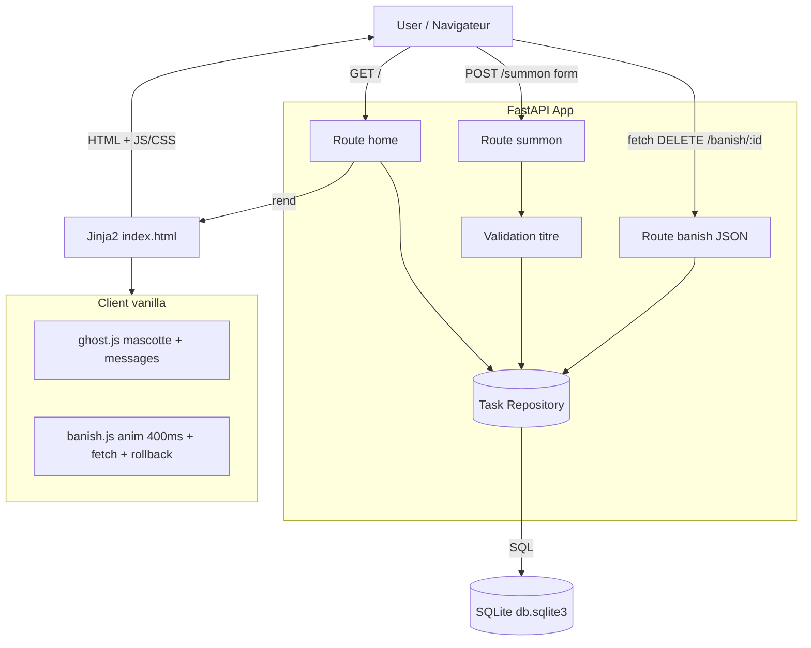

# Design Document

## Overview

Séance est un assistant de productivité hanté où chaque tâche est un « esprit » que l'on *invoque* (ajoute) et *bannit* (complète). L'application est une app web monopage légère servie par **FastAPI**, rendue via **templates Jinja2**, stylée en **HTML/CSS/JS vanilla**, et persistée dans une base **SQLite locale** (`db.sqlite3`). Aucun framework front ni ressource payante n'est utilisé.

Le design part du code existant (`main.py`, `templates/index.html`, `db.sqlite3`) et le fait évoluer pour couvrir l'ensemble des 6 requirements :

- **Validation et robustesse du backend** : rejet des titres vides/espaces, limite 200 caractères avec réponse HTTP 422, 404 sur bannissement d'un esprit inexistant, gestion d'erreurs base de données.
- **Expérience front hantée** : bannissement avec animation de disparition de 400 ms **puis** suppression asynchrone (fetch) sans rechargement complet, restauration en cas d'échec, mascotte fantôme contextuelle avec messages aléatoires non répétitifs.
- **Thème gothique mesurable** : fond sombre (<20 % de luminance), brouillard animé (opacité 0,3–0,6 sur cycle 6–12 s), police Cinzel Decorative avec fallback serif, lueur ambrée/violette, flottement 4–8 px sur 3–5 s, et désactivation totale des animations sous `prefers-reduced-motion`.

### Décisions de conception clés

| Décision | Rationale |
|----------|-----------|
| Bannissement via `fetch` + endpoint JSON plutôt que POST + redirect | Requirement 3 impose une animation de 400 ms *puis* suppression serveur, un rafraîchissement **sans recharger la page**, et une **restauration** de l'élément en cas d'échec. Un POST classique avec redirect ne permet pas la restauration ni le rafraîchissement partiel. |
| Validation centralisée côté serveur | Les règles (non vide, ≤200) doivent tenir même si le client est contourné ; le serveur est la source de vérité (Req 1.2, 1.5, 1.6). |
| Messages de mascotte gérés côté client (JS) | La sélection aléatoire « différente du message précédent » et le passage à l'état vide sont des comportements d'interface réactifs à l'ajout/suppression (Req 6.3, 6.4). Le serveur reste sans état d'affichage. |
| `CHECK(length(title) <= 200)` + colonne `NOT NULL` en base | Garantit l'invariant de données au niveau du stockage (Req 4.2) en plus de la validation applicative. |
| Dégradation gracieuse sur erreur base de données | Req 2.6, 4.5 exigent un message d'erreur et la désactivation des opérations plutôt qu'un crash. |

## Architecture

L'architecture reste un monolithe simple à trois couches, sans dépendance externe.



### Flux principaux

**Invocation (summon)**
1. L'utilisateur soumet le `Summon_Form` (POST `/summon`, `title`).
2. Le serveur normalise (`strip`) et valide : non vide, longueur ≤ 200.
3. Si invalide vide/espaces → re-render de la page avec message d'erreur + valeur saisie conservée (statut 200, aucune insertion).
4. Si trop long (>200) → réponse HTTP 422 avec message d'erreur.
5. Si valide → insertion en base, puis redirection 303 vers `/`.
6. La page liste les esprits par **id décroissant** (plus récent en tête).

**Bannissement (banish)** — piloté par le client
1. Clic sur `Banish_Button` → `banish.js` empêche la soumission par défaut.
2. Ajout de la classe `.banished` → animation de disparition de **400 ms**.
3. À la fin de l'animation : `fetch('/banish/{id}', { method: 'POST' })`.
4. Réponse 2xx → l'élément est retiré du DOM ; si la liste devient vide, la mascotte repasse à l'état « quiet ».
5. Réponse 404 ou erreur réseau → l'élément est **restauré** à sa position d'origine et un message d'erreur s'affiche.

**Chargement de page (home)**
1. GET `/` → récupération de tous les esprits (id DESC).
2. En cas d'échec base → variable `db_error` transmise au template, liste vide, opérations désactivées.
3. Rendu Jinja2 + initialisation JS de la mascotte.

## Components and Interfaces

### Couche serveur (`main.py`)

| Composant | Responsabilité |
|-----------|----------------|
| `get_db()` | Ouvre une connexion SQLite avec `row_factory = sqlite3.Row`. |
| `init_db()` | Crée la table `tasks` avec contrainte de longueur si absente. Capture l'échec pour exposer `DB_READY`. |
| `normalize_and_validate(title)` | Fonction **pure** : `strip`, puis renvoie `(ok, cleaned, error_kind)` où `error_kind ∈ {None, "empty", "too_long"}`. Cœur testable par propriétés. |
| Route `GET /` → `home` | Liste les esprits (id DESC), passe `tasks`, `error`, `db_error` au template. |
| Route `POST /summon` → `summon` | Valide, insère, redirige (303) ou re-render avec erreur / renvoie 422. |
| Route `POST /banish/{task_id}` → `banish` | Supprime l'esprit ; renvoie 303 (ou 200 pour appels fetch) si supprimé, **404** si l'id n'existe pas. |

**Signatures d'interface (contrats)**

```python
def normalize_and_validate(raw_title: str) -> tuple[bool, str, str | None]:
    """Renvoie (is_valid, cleaned_title, error_kind).
    error_kind: None si valide, "empty" si vide/espaces, "too_long" si > 200."""

def list_spirits(conn) -> list[dict]:
    """Esprits triés par id décroissant. Lève une exception si la base est indisponible."""

def insert_spirit(conn, title: str) -> int:
    """Insère un esprit validé, renvoie son id."""

def delete_spirit(conn, task_id: int) -> bool:
    """Supprime l'esprit ; renvoie True si une ligne a été supprimée, False sinon (→ 404)."""
```

**Comportement HTTP**

| Endpoint | Entrée | Succès | Échec |
|----------|--------|--------|-------|
| `GET /` | — | 200 + HTML liste | 200 + HTML avec `db_error` si base KO |
| `POST /summon` | `title` (form) | 303 → `/` | 200 + erreur (vide) ; 422 (trop long) |
| `POST /banish/{id}` | `id` (path) | 303 ou 200 (fetch) | 404 si id absent |

### Couche template (`templates/index.html`)

- `Summon_Form` : champ texte (`maxlength="200"`, `required`) + bouton « Summon ». Affiche un bloc d'erreur si `error` est transmis et **repeuple** le champ avec la valeur saisie.
- `Spirit_List` : `<ul>` itérant `tasks` (déjà triés id DESC), chaque `<li>` affiche `👻 titre` + `Banish_Button` dans un `<form>` ciblé par JS.
- `Ghost_Mascot` : conteneur dédié (`#mascot`) avec emoji fantôme 👻 et zone de message (`#mascot-msg`) ; jamais masqué via CSS.
- Bloc d'erreur base de données affiché et désactivation des formulaires si `db_error`.

### Couche client (JS vanilla, inline ou fichiers statiques)

- `ghost.js` : détient la liste d'au moins 5 messages effrayants, gère la sélection aléatoire **différente du message précédent**, l'état « quiet » quand la liste est vide, et réagit aux ajouts/suppressions.
- `banish.js` : intercepte le submit, joue l'animation 400 ms, envoie le `fetch`, retire ou **restaure** l'élément, met à jour la mascotte.

## Data Models

### Table `tasks` (SQLite)

```sql
CREATE TABLE IF NOT EXISTS tasks (
    id    INTEGER PRIMARY KEY AUTOINCREMENT,
    title TEXT NOT NULL CHECK (length(title) <= 200)
);
```

| Colonne | Type | Contraintes | Description |
|---------|------|-------------|-------------|
| `id` | INTEGER | PK, AUTOINCREMENT | Identifiant d'esprit ; l'ordre décroissant reflète l'ordre d'invocation inverse. |
| `title` | TEXT | NOT NULL, `length ≤ 200` | Titre de l'esprit, normalisé (`strip`) avant insertion. |

### Modèle logique côté application

```python
# Esprit transmis au template
Spirit = { "id": int, "title": str }

# Résultat de validation (fonction pure)
ValidationResult = tuple[bool, str, str | None]  # (ok, cleaned_title, error_kind)
```

### Messages de la mascotte (côté client)

```javascript
const QUIET = "The house is quiet… for now.";
const SPOOKY = [
  "Something stirs in the walls…",
  "A cold draft passes through the room…",
  "The candle flickers without a breeze…",
  "You are not alone in here…",
  "The floorboards creak behind you…",
  "A whisper calls your name…"
]; // ≥ 5 messages distincts
```

Règle de sélection : choisir un message aléatoire de `SPOOKY` **différent du dernier affiché** (Req 6.3).

## Correctness Properties

*A property is a characteristic or behavior that should hold true across all valid executions of a system — essentially, a formal statement about ce que le système doit faire. Les propriétés font le pont entre une spécification lisible par un humain et des garanties de correction vérifiables par la machine.*

Ces propriétés portent sur la **logique métier testable** de Séance : validation des titres, persistance et ordonnancement en base, sélection des messages de la mascotte, et restauration DOM lors d'un bannissement échoué. Les aspects purement visuels (thème, animations CSS, présence DOM) ne sont pas exprimés en propriétés universelles et sont couverts par des tests d'exemple/inspection (voir Testing Strategy).

### Property 1: Invocation d'un titre valide persiste le titre normalisé

*For any* titre dont la version `strip`-ée est non vide et de longueur ≤ 200, l'invoquer via le flux de summon doit insérer en base exactement un esprit dont le titre est égal à cette version normalisée (sans espaces en tête/fin), récupérable ensuite dans la liste.

**Validates: Requirements 1.2**

### Property 2: Les titres composés uniquement d'espaces sont rejetés

*For any* chaîne composée exclusivement de caractères d'espacement (y compris chaîne vide et whitespace unicode), la validation doit la rejeter avec `error_kind = "empty"`, sans insérer aucune ligne en base, et la valeur saisie doit être conservée pour réaffichage.

**Validates: Requirements 1.4**

### Property 3: La limite de 200 caractères est respectée à la frontière

*For any* titre, après normalisation, la validation doit l'accepter si et seulement si sa longueur est ≤ 200 ; tout titre normalisé de longueur > 200 doit être rejeté avec `error_kind = "too_long"` et aucune insertion.

**Validates: Requirements 1.5**

### Property 4: Les esprits sont listés en identifiant décroissant

*For any* ensemble d'esprits présents en base, la liste renvoyée par le listing doit être triée par identifiant strictement décroissant, de sorte que l'esprit le plus récemment invoqué apparaisse en tête.

**Validates: Requirements 1.7, 2.2**

### Property 5: Le listing récupère exactement l'ensemble stocké

*For any* ensemble d'esprits écrits en base, le listing doit renvoyer exactement cet ensemble d'identifiants et de titres — sans perte, sans doublon et sans ajout.

**Validates: Requirements 2.1**

### Property 6: La sélection d'un message spooky appartient à l'ensemble et diffère du précédent

*For any* message précédemment affiché, la sélection d'un nouveau message d'ambiance doit renvoyer un élément appartenant à l'ensemble prédéfini `SPOOKY` (qui contient au moins 5 messages distincts) et différent du message précédent lorsque l'ensemble contient au moins deux éléments.

**Validates: Requirements 2.4, 6.3**

### Property 7: Le bannissement retire la cible et préserve les autres esprits

*For any* ensemble non vide d'esprits et tout identifiant existant choisi, supprimer cet esprit doit produire une liste qui ne contient plus cet identifiant mais conserve exactement tous les autres esprits inchangés.

**Validates: Requirements 3.1**

### Property 8: L'échec d'un bannissement restaure la liste à son état initial (round-trip DOM)

*For any* liste d'esprits affichée et tout esprit ciblé, si la requête de suppression échoue (404 ou erreur réseau), l'état final de la `Spirit_List` (ordre et contenu des éléments) doit être identique à son état avant la tentative de bannissement.

**Validates: Requirements 3.4**

### Property 9: La persistance survit au redémarrage (round-trip de cycle de vie)

*For any* ensemble d'esprits écrits en base puis lus via une nouvelle connexion (simulant un redémarrage de l'App), l'ensemble des esprits lus (identifiants et titres) doit être exactement égal à l'ensemble écrit avant fermeture.

**Validates: Requirements 4.3**

## Error Handling

| Situation | Exigence | Comportement de conception |
|-----------|----------|----------------------------|
| Titre vide / uniquement espaces (Req 1.4) | Rejet sans insertion, erreur visible, valeur conservée | `normalize_and_validate` renvoie `error_kind="empty"` ; `summon` re-render la page (200) avec `error` et la valeur saisie, aucune écriture base. |
| Titre > 200 caractères (Req 1.6) | HTTP 422 + message de limite | `summon` renvoie une réponse 422 (`JSONResponse`/`HTTPException`) avec un message indiquant la limite ; le template affiche aussi `maxlength=200` côté client comme garde-fou non suffisant. |
| Id d'esprit inexistant au bannissement (Req 3.5) | HTTP 404 | `delete_spirit` renvoie `False` → `banish` lève `HTTPException(404)`. |
| Échec du `fetch` de bannissement : 404 ou réseau (Req 3.4) | Restaurer l'élément + message d'erreur | `banish.js` capture l'erreur/le statut non-2xx, ré-insère le `<li>` à son index d'origine et affiche un message dans une zone dédiée. |
| Échec de récupération des esprits (Req 2.6) | Message d'erreur + aucune liste | `home` capture l'exception SQLite, passe `db_error=True` et `tasks=[]` au template. |
| Échec d'initialisation de la base au démarrage (Req 4.5) | Message d'erreur + opérations désactivées | `init_db` capture l'échec et fixe `DB_READY=False` ; les routes `summon`/`banish` renvoient une erreur explicite et le template désactive les formulaires. |

Principes :
- La validation côté serveur est la source de vérité ; les gardes HTML (`required`, `maxlength`) améliorent l'UX mais ne remplacent pas la validation.
- Aucune exception non capturée ne doit atteindre l'utilisateur sous forme de trace brute ; chaque chemin d'erreur produit un message lisible.
- Les réponses d'erreur distinguent explicitement « vide » (200 + re-render) et « trop long » (422), conformément aux requirements.

## Testing Strategy

L'approche combine **tests unitaires/exemples**, **tests de propriétés** (sur la logique métier pure) et **tests d'inspection** pour les aspects visuels non exprimables en propriétés universelles.

### Approche duale

- **Tests de propriétés** : couvrent les 9 propriétés ci-dessus (validation, ordonnancement, persistance, sélection de message, suppression, restauration). Chaque propriété est implémentée par **un seul** test de propriété.
- **Tests d'exemple / unitaires** : couvrent les comportements déterministes et les cas précis — redirection 303 (1.3), statut 422 (1.6), statut 404 (3.5), message « quiet » sur liste vide (2.3, 3.6, 6.4), dégradation sur erreur base (2.6, 4.5), idempotence d'`init_db` (4.1), schéma (4.2).
- **Tests d'interaction JS** : séquence animation 400 ms → fetch (3.2), retrait DOM sans reload (3.3), présence/non-masquage de la mascotte (6.1).
- **Tests d'inspection / snapshot CSS** : thème gothique mesurable (5.1 luminance <20 %, 5.2 fog, 5.3 police + fallback, 5.4 teinte glow, 5.5 flottement, 5.6/6.6 `prefers-reduced-motion`, 6.5 ressource de mascotte).

### Bibliothèques et configuration

- **Langage cible : Python** pour la logique serveur → bibliothèque de property-based testing **Hypothesis** (ne pas réimplémenter le PBT à la main).
- **FastAPI** : `fastapi.testclient.TestClient` pour les tests d'exemple HTTP (303, 422, 404).
- **Logique JS** (sélection de message, restauration DOM) : exprimée comme fonctions pures testables ; propriétés testées côté Python si la logique est partagée côté serveur, sinon via un harnais JS léger (ex. `fast-check` + jsdom). Pour cette feature, la **sélection de message** et la **restauration** peuvent être validées en Python en modélisant la fonction de sélection (liste + dernier message) et l'ordre de la liste.

### Règles pour les tests de propriétés

- Minimum **100 itérations** par test de propriété (`@settings(max_examples=100)` sous Hypothesis).
- Chaque test de propriété référence la propriété de conception correspondante via un commentaire au format :
  **Feature: seance-haunted-productivity, Property {number}: {property_text}**
- Les générateurs couvrent explicitement les cas limites pertinents : chaînes whitespace unicode, titres de longueur exactement 199/200/201, ensembles vides et de grande taille, messages précédents égaux à chaque élément de `SPOOKY`.

### Couverture par propriété (récapitulatif)

| Propriété | Test | Itérations |
|-----------|------|-----------|
| P1 Invocation → persistance normalisée | property | ≥100 |
| P2 Rejet whitespace | property | ≥100 |
| P3 Frontière 200 | property | ≥100 |
| P4 Ordre id décroissant | property | ≥100 |
| P5 Listing = ensemble stocké | property | ≥100 |
| P6 Sélection message ∈ SPOOKY et ≠ précédent | property | ≥100 |
| P7 Suppression cible, préserve autres | property | ≥100 |
| P8 Restauration DOM après échec | property | ≥100 |
| P9 Persistance au redémarrage | property | ≥100 |

### Équilibre des tests unitaires

Les tests unitaires restent ciblés : codes de statut HTTP, messages fixes de la mascotte, chemins d'erreur base de données, et vérifications de schéma. Les variations d'entrée larges sont déléguées aux tests de propriétés pour éviter la prolifération de cas unitaires.
